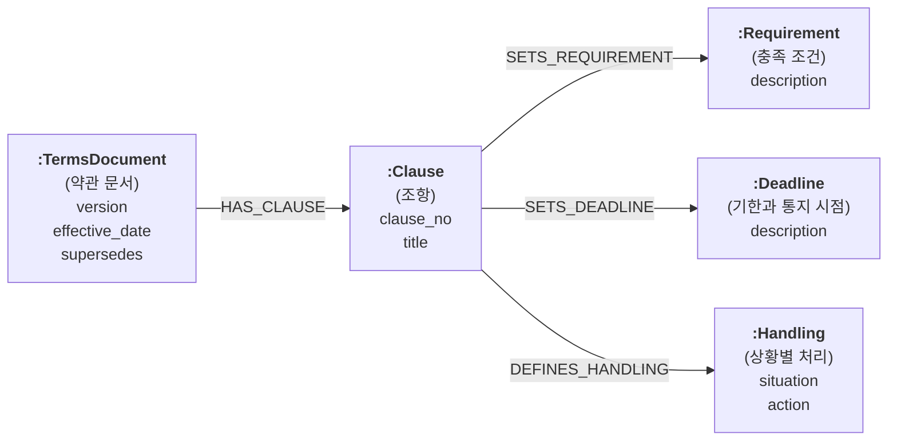
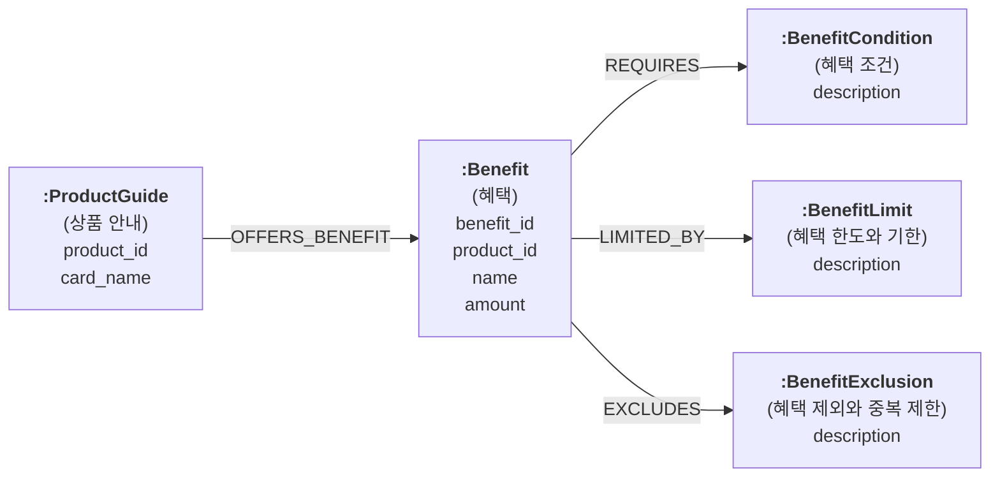
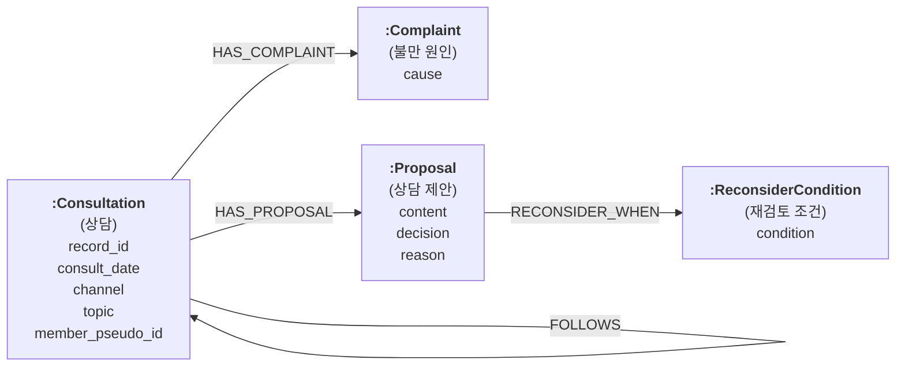

# 문서 스키마 설계 프롬프트 실행 결과  

> 프롬프트: `hybrid-ai-lab/prompts/design-kg-schema-doc.md`  
> 실행 방식: 입력값은 AI가 프로젝트에서 찾아 채움. `[승인]` 단계는 사용자 지시로 모두 자동 승인함  
> 자동 승인이므로 사람 검토를 거친 확정본이 아님. 실제 사용 전에 사람이 다시 승인해야 함  

## 1. 자동으로 채운 입력값  

| 입력 | 값 | 찾은 근거 |
|---|---|---|
| 출력 기준 폴더 | `hybrid-ai-lab/verify/doc-schema-prompt-run` | 승인이 자동이라 인덱서가 아닌 verify 아래에 둠 |
| 청크 위치 파일 | `hybrid-ai-lab/indexer/vector-bm25/data/active_generation.json` | 인덱서의 활성 세대 기록 |
| 찾은 청크 파일 | `hybrid-ai-lab/indexer/vector-bm25/data/artifacts/birthfix-20261018b/prepared-chunks.json` | 이름 규칙 일치: gen-{실행 ID}-{해시}의 실행 ID = 산출물 폴더 'birthfix-20261018b'; 청크 수 일치: 218개 |
| 본문 칸 | `text` | 정제 본문. `index_text`는 검색용 별칭을 덧붙인 칸이라 뺌 |
| 문서 종류 칸 | `metadata.doc_type` | 값 3종: regulation 10건, benefit_guide 160건, consult_log 48건 |
| 사용자 질문 출처 | `hybrid-ai-lab/ragas/eval-set.json` `hybrid-ai-lab/indexer/vector-bm25/evaluation/group2_questions.json` `hybrid-ai-lab/specs/userstory.md` | 평가용 질문셋 2개(Q01 ~ Q22, E01 ~ E20)와 사용자 스토리 |
| 정형 데이터 그래프 스키마 | `hybrid-ai-lab/indexer/graphrag/schema/graph_schema.json` | RDB에서 만든 GraphSchema(Product, Card, Member 등) |
| 기존 정답표 | `hybrid-ai-lab/docs/_instructor/D3/상담근거_대조표.jsonl` `hybrid-ai-lab/docs/_instructor/D3/정제검증_기대값.json` | 상담 기록만 있음. 약관과 혜택은 LLM이 기대 답 초안을 씀 |
| LLM | groq `openai/gpt-oss-120b` | 프로젝트 공용 모델 |
| 비밀값 | `secrets/.env`의 `GROQ_API_KEY` | 값이 있는지만 확인함(값은 보지 않음) |
| 도구 판 | neo4j-graphrag 1.22.0 | 검증 가상환경 |
| Neo4j 판 | Community(이미지 neo4j:2026.09.0-community) → 제약은 UNIQUENESS만 사용 | 컨테이너 이미지 이름 |

- 개인정보 점검(정규식): 전화번호 0건, 이메일 0건, 카드나 계좌 번호 0건, 주민번호 0건, 생년월일 0건  

## 2. 묶음과 표본  

| 문서 종류 | 묶음 기준 | 묶음(청크 수) | 발견용 상한 | 시험용 |
|---|---|---|---:|---:|
| 약관 | 묶음 하나(조항 단위 전체) | 약관 조항 전체(10) | 17 | 30 |
| 혜택 안내 | section_label 값의 모양 | 공통 안내(4), 참고 카드(7), 카드 개요(64), 혜택 상세(85) | 68 | 40 |
| 상담 기록 | source(상담 시나리오 파일) | D3_S01_신규가입(8), D3_S02_장기보유(8), D3_S03_VIP(8), D3_S04_휴면직전(8), D3_S05_다중카드(8), D3_S06_연회비부담(8) | 30 | 18 |

- 약관: 청크 10건 중 10건만 나눔 → 단위 시험용 30건, 발견용 17건(목표 시험용 30 ~ 50건)  
- 혜택 안내: 청크 160건 → 시험용 40건(목표 30 ~ 50건)  
- 상담 기록: 청크 48건 → 시험용 18건(목표 30 ~ 50건) 모자람: 청크가 적어 시험용을 줄임  

## 3. 문서 종류별 결과  

### 3.1 약관(regulation)  

- 후보: 호출 17건(성공 17, 실패 0), 노드 타입 이름 42개, 관계 이름 63개  

추천표(자동 승인)  

| 구분 | 추천 | 근거 질문 |
|---|---|---|
| 병합 | Document, ElectronicDocument → TermsDocument(약관 문서) | R5 |
| 병합 | Condition, Limit → Requirement(충족 조건) | R2 |
| 병합 | Notification, Report → Deadline(기한과 통지 시점) | R3 |
| 병합 | Action, Reason, Cancellation, Request → Handling(상황별 처리) | R4 |
| 추가 | TermsDocument.version, effective_date, supersedes(머리줄에서 채움, 후보에 1건뿐) | R5 |
| 추가 | Clause.clause_no, title(조항 번호와 제목) | R1 |
| 제거 | Card, Member, PrimaryMember, FamilyMember, Transaction, Approval, Fee(정형 스키마에 이미 있거나 개인 단위 데이터) | 없음 |
| 제거 | CardIssuer, Party, CardApplication(어느 역량 질문에도 안 쓰임) | 없음 |
| 병합 | 조항 단위 후보의 ProcessingStandard, Withdrawal → Handling(상황별 처리) | R4 |
| 병합 | 조항 단위 후보의 Change.notice_period_days → Deadline(미리 알리는 시점) | R3 |
| 병합 | 조항 단위 후보의 Agreement, Specification의 금액 조건 → Requirement | R2 |
| 제거 | Term, Footnote, Statement, ExchangeRate, Currency, Applicant, Application(어느 역량 질문에도 안 쓰이거나 개인 단위 데이터) | 없음 |
| 추가 | Clause 비해당에 차례(목차) 조항, Handling과 Deadline 경계 명시(청크 단위 시험 결과 반영, 유지) | R1, R3, R4 |
| 병합 | 조항 단위 후보의 Article → Clause(같은 뜻) | R1 |
| 병합 | 조항 단위 후보의 TransactionSituation, Procedure, IncidentResponseProcedure, Refund, Cancellation → Handling(상황별 처리) | R4 |
| 병합 | 조항 단위 후보의 ChangeEvent, Clause.notice_period_days → Deadline(미리 알리는 시점) | R3 |
| 유지 | 조항 단위 후보의 Requirement → Requirement(이름 그대로) | R2 |
| 제거 | Transaction, Member, Merchant, Account, Fee(정형 스키마에 있거나 개인 단위 데이터), CardCompany, Person, Purpose, RetentionPolicy 등 1건씩 나온 이름(어느 역량 질문에도 안 쓰임) | 없음 |
| 추가 | Clause 비해당에 차례(목차) 조항, Handling과 Deadline 경계 명시(청크 단위 시험 결과 반영, 유지) | R1, R3, R4 |
| 추가 | Requirement 비해당에 일반 의무, Deadline 해당에 미리 알리는 시점과 상황 조건이 붙은 시점(조항 단위 라운드 1 결과) | R2, R3 |
| 추가 | Requirement를 숫자 기준이나 '~인 경우에만' 꼴로 좁힘, Deadline은 시점마다 하나씩(조항 단위 라운드 2 결과) | R2, R3 |

채우기 시험(마지막 라운드 3)  

| 질문 | 뽑음 | 잘못 뽑음 | 값 같음 | 판정 |
|---|---:|---:|---:|---|
| R1 | 30 / 30(100%) | 0 / 0(해당 없음) | 24 / 30(80%) | 통과 |
| R2 | 2 / 6(33%) | 2 / 24(8%) | 1 / 2(50%) | 미달 |
| R3 | 9 / 16(56%) | 0 / 14(0%) | 3 / 9(33%) | 미달 |
| R4 | 8 / 9(89%) | 16 / 21(76%) | 8 / 8(100%) | 미달 |
| R5 | 30 / 30(100%) | 0 / 0(해당 없음) | 7 / 30(23%) | 미달 |

- 최종 파일: 만들지 않음(합격 기준 미달)  

### 3.2 혜택 안내(benefit_guide)  

- 후보: 호출 47건(성공 44, 실패 3), 노드 타입 이름 31개, 관계 이름 43개  

추천표(자동 승인)  

| 구분 | 추천 | 근거 질문 |
|---|---|---|
| 병합 | Benefit, BenefitProgram, Offer, Bonus, BenefitTier → Benefit | B1 |
| 병합 | Condition, Channel, MerchantCategory, TransactionType, Target → BenefitCondition(대상 가맹점이나 채널은 조건 속성으로) | B2 |
| 병합 | Limit, TimeWindow, PaymentTiming → BenefitLimit | B3 |
| 병합 | Exclusion, Restriction → BenefitExclusion | B4 |
| 병합 | Card(문서 쪽 카드 상품) → ProductGuide(정형 Product와 이름이 겹치지 않게 '상품 안내'로 둠) | B5 |
| 추가 | ProductGuide.product_id, Benefit.product_id(정형 Product.product_id에 잇는 키, 머리줄에서 채움) | B1, B5 |
| 추가 | ProductGuide.issue_target, payment_limit(후보에 거의 없음) | B5 |
| 제거 | Fee, FeeComponent, AnnualFee(정형 스키마 ProductAnnualFee에 이미 있음) | 없음 |
| 제거 | Issuer, Provider, Brand, Company, Document, Account, Transaction(어느 역량 질문에도 안 쓰이거나 정형에 있음) | 없음 |
| 제거 | ProductGuide.issue_target, payment_limit. B5의 기대 답 16건이 모두 연회비나 가족카드 규칙이라 정형 스키마(ProductAnnualFee, Product.family_card_rule)가 답함 → 문서 쪽 시험에서 B5 뺌 | B5 |

채우기 시험(마지막 라운드 3)  

| 질문 | 뽑음 | 잘못 뽑음 | 값 같음 | 판정 |
|---|---:|---:|---:|---|
| B1 | 35 / 35(100%) | 0 / 5(0%) | 28 / 35(80%) | 통과 |
| B2 | 36 / 36(100%) | 0 / 4(0%) | 35 / 36(97%) | 통과 |
| B3 | 36 / 36(100%) | 0 / 4(0%) | 35 / 36(97%) | 통과 |
| B4 | 36 / 36(100%) | 0 / 4(0%) | 36 / 36(100%) | 통과 |

- 최종 파일: `benefit_guide/graph_schema.json`, `benefit_guide/approval.json`  

### 3.3 상담 기록(consult_log)  

- 후보: 호출 30건(성공 30, 실패 0), 노드 타입 이름 50개, 관계 이름 117개  

추천표(자동 승인)  

| 구분 | 추천 | 근거 질문 |
|---|---|---|
| 병합 | Consultation, Conversation, Record, ConsultationRecord, Interaction, Call, Communication → Consultation | C5 |
| 병합 | Issue와 Request 중 불편이나 불만을 말한 것 → Complaint(cause) | C1 |
| 병합 | Proposal, Guidance, Procedure → Proposal(content) | C2 |
| 병합 | Channel, CommunicationChannel, MessageChannel → Consultation.channel 속성 | C5 |
| 추가 | Proposal.decision, Proposal.reason(후보에 거의 없음) | C3 |
| 추가 | ReconsiderCondition(후보에 Condition 1건뿐) | C4 |
| 추가 | FOLLOWS(Consultation → Consultation, 후보 3건) | C5 |
| 추가 | Consultation.member_pseudo_id(정형 Member에 잇는 키 후보. 청크에는 가명 ID만 있어 Member.member_id로 바로 잇지 못함) | C5 |
| 제거 | Customer의 name, email, contact(개인정보 처리 대상) | 없음 |
| 제거 | Transaction, TransactionSummary, TransactionBatch(정형 스키마 CardTxn에 이미 있음) | 없음 |
| 제거 | Card(정형 스키마에 이미 있음) | 없음 |
| 제거 | Agent, Counselor, Address, Device, Menu, Preference 계열(어느 역량 질문에도 안 쓰임) | 없음 |

채우기 시험(마지막 라운드 5)  

| 질문 | 뽑음 | 잘못 뽑음 | 값 같음 | 판정 |
|---|---:|---:|---:|---|
| C1 | 12 / 12(100%) | 1 / 6(17%) | 12 / 12(100%) | 통과 |
| C2 | 18 / 18(100%) | 0 / 0(해당 없음) | 18 / 18(100%) | 통과 |
| C3 | 17 / 18(94%) | 0 / 0(해당 없음) | 14 / 17(82%) | 통과 |
| C4 | 10 / 10(100%) | 0 / 8(0%) | 10 / 10(100%) | 통과 |
| C5 | 14 / 14(100%) | 0 / 4(0%) | 14 / 14(100%) | 통과 |

- 최종 파일: `consult_log/graph_schema.json`, `consult_log/approval.json`  

## 4. 주의와 남은 쟁점  

- 자동 승인: 역량 질문, 묶음, 스키마 초안, 제약, 기대 답, 합격 기준, 시험 통과를 사람이 보지 않고 AI가 정함  
- 기대 답: 약관과 혜택은 정답표가 없어 시험에 쓰는 모델과 같은 모델이 초안을 씀. 채점이 후하게 나올 수 있음  
- 표본 부족: 약관 시험용 5건, 상담 18건으로 목표 30 ~ 50건보다 적음(청크 수 자체가 적음)  
- 상담 C1: 라운드 4는 잘못 뽑음 2 / 6으로 미달, 같은 설명의 라운드 5는 1 / 6으로 통과. 기준(20%)에 붙어 있어 다시 돌리면 바뀔 수 있음. 잘못 뽑은 문장은 고객의 실제 불편 진술이라 정답표 범위를 다시 볼 필요가 있음  
- 혜택 B5(카드 기본 이용 조건): 기대 답 16건이 모두 연회비나 가족카드 규칙이라 정형 스키마가 답하는 질문으로 옮김  
- 약관(청크 단위, 1차): 청크 하나가 조항 7 ~ 30개를 묶고 2건은 차례(목차)로 시작해 추출이 조항 목록에 쏠림. 라운드 2에서 5건 모두 조항과 문서 노드만 나와 중단함. 기록은 `output/regulation-chunk-run/`  
- 약관(조항 단위, 2차): 표본으로 뽑힌 청크만 조항으로 나눔(검색 청크는 그대로). 시험용 30건, 발견용 17건. 조건, 기한, 처리 노드가 실제로 뽑히기 시작했으나 라운드 3에서도 R2 ~ R5 미달로 중단함  
  - R2: 답 있는 표본이 6건뿐이라 설명을 좁히면 뽑음이, 넓히면 잘못 뽑음이 흔들림  
  - R4: 잘못 뽑음 16 / 21 중 다수가 '~경우 ~안내합니다' 꼴의 실제 상황별 처리 문장이라 기대 답 초안이 좁아 보임  
  - R5: 30건 모두 판, 시행일, 이전 판을 정확히 뽑았으나 기대 답에 'version:' 같은 이름표가 붙어 채점에서 떨어짐  
  - 다음 단계: 사람이 시험용 30건의 기대 답(R2 ~ R5)을 검토한 뒤 다시 시험해야 판정이 의미 있음  
- 도구 발견: neo4j-graphrag 1.22.0은 required 속성을 EXISTENCE 제약으로 바꿈. Community 판이 지원하지 않아 required를 모두 false로 두고 다시 시험함  

## 5. 단계별 결정 기록  

| 단계 | 판 | 판정자 | 일시 |
|---|---:|---|---|
| 1. 사용자 입력 | 1 | 자동 승인(사용자 지시: 승인은 자동 승인 처리, 2026-10-18) | 2026-10-18 23:24 |
| 2. 역량 질문 | 1 | 자동 승인(사용자 지시: 승인은 자동 승인 처리, 2026-10-18) | 2026-10-18 23:24 |
| 3. 묶음 기준과 표본 계획 | 1 | 자동 승인(사용자 지시: 승인은 자동 승인 처리, 2026-10-18) | 2026-10-18 23:24 |
| 5. 스키마 초안 추천과 확정(regulation) | 1 | 자동 승인(사용자 지시: 승인은 자동 승인 처리, 2026-10-18) | 2026-10-18 23:34 |
| 6. 기계 검증(regulation) | 1 | 실행 로그(승인 단계 아님) | 2026-10-18 23:34 |
| 5. 스키마 초안 추천과 확정(benefit_guide) | 1 | 자동 승인(사용자 지시: 승인은 자동 승인 처리, 2026-10-18) | 2026-10-18 23:34 |
| 6. 기계 검증(benefit_guide) | 1 | 실행 로그(승인 단계 아님) | 2026-10-18 23:34 |
| 5. 스키마 초안 추천과 확정(consult_log) | 1 | 자동 승인(사용자 지시: 승인은 자동 승인 처리, 2026-10-18) | 2026-10-18 23:34 |
| 6. 기계 검증(consult_log) | 1 | 실행 로그(승인 단계 아님) | 2026-10-18 23:34 |
| 7. 기대 답과 합격 기준(consult_log) | 1 | 자동 승인(사용자 지시: 승인은 자동 승인 처리, 2026-10-18) | 2026-10-18 23:34 |
| 8. 채우기 시험 판정(consult_log, 라운드 1) | 1 | 자동 승인(사용자 지시: 승인은 자동 승인 처리, 2026-10-18) | 2026-10-18 23:34 |
| 8. 채우기 시험 판정(consult_log, 라운드 2) | 1 | 자동 승인(사용자 지시: 승인은 자동 승인 처리, 2026-10-18) | 2026-10-18 23:35 |
| 7. 기대 답과 합격 기준(regulation) | 1 | 자동 승인(사용자 지시: 승인은 자동 승인 처리, 2026-10-18) | 2026-10-18 23:36 |
| 8. 채우기 시험 판정(consult_log, 라운드 3) | 1 | 자동 승인(사용자 지시: 승인은 자동 승인 처리, 2026-10-18) | 2026-10-18 23:36 |
| 7. 기대 답과 합격 기준(benefit_guide) | 1 | 자동 승인(사용자 지시: 승인은 자동 승인 처리, 2026-10-18) | 2026-10-18 23:37 |
| 8. 채우기 시험 판정(consult_log, 라운드 4) | 1 | 자동 승인(사용자 지시: 승인은 자동 승인 처리, 2026-10-18) | 2026-10-18 23:40 |
| 8. 채우기 시험 판정(regulation, 라운드 1) | 1 | 자동 승인(사용자 지시: 승인은 자동 승인 처리, 2026-10-18) | 2026-10-18 23:40 |
| 8. 채우기 시험 판정(benefit_guide, 라운드 1) | 1 | 자동 승인(사용자 지시: 승인은 자동 승인 처리, 2026-10-18) | 2026-10-18 23:41 |
| 8. 채우기 시험 판정(regulation, 라운드 2) | 1 | 자동 승인(사용자 지시: 승인은 자동 승인 처리, 2026-10-18) | 2026-10-18 23:41 |
| 8. 채우기 시험 판정(benefit_guide, 라운드 2) | 1 | 자동 승인(사용자 지시: 승인은 자동 승인 처리, 2026-10-18) | 2026-10-18 23:42 |
| 6. 기계 검증(재실행, 3종) | 1 | 실행 로그(승인 단계 아님) | 2026-10-18 23:43 |
| 8. 채우기 시험 판정(benefit_guide, 라운드 3) | 1 | 자동 승인(사용자 지시: 승인은 자동 승인 처리, 2026-10-18) | 2026-10-18 23:44 |
| 8. 채우기 시험 판정(consult_log, 라운드 5) | 1 | 자동 승인(사용자 지시: 승인은 자동 승인 처리, 2026-10-18) | 2026-10-18 23:44 |
| 3. 묶음 기준과 표본 계획(regulation) | 1 | 자동 승인(사용자 지시: 승인은 자동 승인 처리, 2026-10-18) | 2026-10-18 23:58 |
| 3. 추출 단위 제안(regulation) | 1 | 자동 승인(사용자 지시: 승인은 자동 승인 처리, 2026-10-18) | 2026-10-19 00:00 |
| 5. 스키마 초안 추천과 확정(regulation, 조항 단위) | 1 | 자동 승인(사용자 지시: 승인은 자동 승인 처리, 2026-10-18) | 2026-10-19 00:00 |
| 3. 묶음 기준과 표본 계획(regulation) | 2 | 자동 승인(사용자 지시: 승인은 자동 승인 처리, 2026-10-18) | 2026-10-19 00:04 |
| 3. 추출 단위 제안(regulation) | 2 | 자동 승인(사용자 지시: 승인은 자동 승인 처리, 2026-10-18) | 2026-10-19 00:06 |
| 5. 스키마 초안 추천과 확정(regulation, 조항 단위) | 2 | 자동 승인(사용자 지시: 승인은 자동 승인 처리, 2026-10-18) | 2026-10-19 00:06 |
| 8. 채우기 시험 판정(regulation 조항 단위, 라운드 1) | 1 | 자동 승인(사용자 지시: 승인은 자동 승인 처리, 2026-10-18) | 2026-10-19 00:09 |
| 7. 기대 답 검토 수정(regulation) | 1 | 자동 승인(사용자 지시: 승인은 자동 승인 처리, 2026-10-18) | 2026-10-19 00:09 |
| 8. 채우기 시험 판정(regulation 조항 단위, 라운드 2) | 1 | 자동 승인(사용자 지시: 승인은 자동 승인 처리, 2026-10-18) | 2026-10-19 00:10 |
| 8. 채우기 시험 판정(regulation 조항 단위, 라운드 3) | 1 | 자동 승인(사용자 지시: 승인은 자동 승인 처리, 2026-10-18) | 2026-10-19 00:11 |
