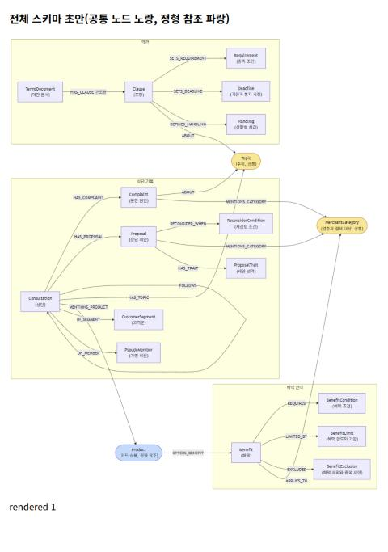

# 5단계 승인: 스키마 초안(공통 개념, 참조 노드, 메타데이터 노드, 문서 종류별 초안)

- 승인할 것: 세 문서 종류의 스키마 초안과 공통 개념 정의(`shared_concepts.json`)
- 승인하면: 6단계 기계 검증을 거쳐 7단계에서 시험용 표본의 기대 답 초안을 만듦

## 0. 4단계 후보 뽑기 결과(승인 대상 아님, 판단 근거)

**개념 설명.** 4단계는 발견용 표본을 한 건씩 LLM에 넣고 "이 글에 어떤 종류의 엔티티와 관계가 있나"를 물은 단계임.
나온 이름이 스키마 초안의 재료가 됨. 판단은 나온 횟수가 아니라 역량 질문에 필요한지로 함.

| 문서 종류 | LLM 호출 | 실패 | 노드 타입 이름 | 관계 이름 | 멈춘 이유 |
|---|---:|---:|---:|---:|---|
| 약관 | 20 | 0 | 41 | 68 | 상한까지 모두 봄 |
| 혜택 안내 | 39 | 1 | 18 | 41 | 카드 개요 18건, 혜택 상세 13건에서 새 이름이 3건 잇달아 없어 멈춤. 본문 아님은 8건 모두 봄 |
| 상담 기록 | 30 | 0 | 57 | 125 | 고객군마다 5건 모두 봄 |

열 뜻

- LLM 호출: 발견용 표본을 넣은 횟수. 사용 토큰은 세 문서 종류 합계 369,592개
- 실패: LLM 응답이 스키마 꼴 검사에 걸린 호출(혜택 1건: 같은 속성에 제약을 두 번 넣음). 사유만 남기고 넘어감
- 노드 타입 이름, 관계 이름: 나온 서로 다른 이름의 수(대소문자와 띄어쓰기 차이는 같은 이름으로 셈)

문서 종류를 건너 함께 나온 이름(공통 개념 후보의 근거)

| 이름 | 약관 | 혜택 안내 | 상담 기록 | 판단 |
|---|---:|---:|---:|---|
| Card(카드) | 2 | 38 | 11 | 정형 Product 참조 노드로 받음(2절) |
| Benefit(혜택) | 0 | 31 | 4 | 혜택 안내 쪽 노드로 둠. 상담은 카드를 거쳐 이음 |
| Channel(결제 경로), MerchantCategory(업종) | 1, 0 | 14, 4 | 1, 1 | 하나로 합쳐 공통 노드 MerchantCategory로 둠(1절) |
| Condition(조건), Fee(수수료) | 2, 1 | 21, 4 | 0, 0 | 문서 종류마다 뜻이 달라 공통으로 두지 않음 |

- 질문이 필요로 하는 "주제"와 "고객군"은 후보에 저절로 나오지 않음. 그래서 1절과 3절에서 역량 질문을 근거로 추가함

## 1. 공통 개념

**개념 설명.** 공통 개념은 여러 문서 종류에 함께 나오는 개념을 같은 노드 하나로 두는 것임.
예를 들어 상담의 "연회비 불만"과 약관의 "제9조 연회비 부과"가 같은 주제 노드 "연회비"에 이어지면, 그래프에서 상담과 약관이 이어짐.
같은 노드로 합쳐지려면 이름이 글자까지 같아야 하므로, 대표 이름을 정하는 규칙이 꼭 필요함.

| 공통 노드 | 한글 이름 | 쓰는 문서 종류 | 잇는 관계 | 대표 이름 규칙 | 근거 질문 |
|---|---|---|---|---|---|
| Topic | 주제 | 약관, 상담 기록 | 조항 -ABOUT-> 주제 불만 -ABOUT-> 주제 상담 -HAS_TOPIC-> 주제 | 아래 목록 15개에서만 고름 | X1, A1 |
| MerchantCategory | 업종과 결제 대상 | 혜택 안내, 상담 기록 | 혜택 -APPLIES_TO-> 업종 불만, 제안 -MENTIONS_CATEGORY-> 업종 | 띄어쓰기를 없앤 꼴로 맞추고, 8단계 시험에서 나온 이름으로 동의어 표를 만들어 합침 | X1 |

열 뜻

- 공통 노드: 그래프에 쓰는 영문 이름(라벨)
- 쓰는 문서 종류: 이 노드가 들어가는 문서 종류 스키마. 모든 곳에 같은 라벨, 설명, 키로 넣음
- 잇는 관계: 어느 노드가 어떤 관계로 공통 노드에 이어지는지(화살표 방향 포함)
- 대표 이름 규칙: 같은 대상이 다른 글자로 나와도 노드 하나로 합쳐지게 하는 규칙
- 근거 질문: 이 공통 노드가 필요한 역량 질문 번호

### 주제 대표 이름 목록(15개)

약관 조항 제목 52개와 상담 메타데이터 주제 12개를 함께 보고 묶음. 한 주제가 너무 많은 조항에 붙으면 묶는 힘이 없어지므로
주제마다 조항이 2 ~ 7개가 되게 나눔.

| 주제 | 이 주제의 조항 | 이 주제로 바꾸는 상담 주제 |
|---|---|---|
| 연회비 | 제9조, 제10조 | 연회비 대비 가치 |
| 부가서비스와 포인트 | 제17조, 제18조 | 혜택 불일치, 생활비 절약 |
| 본인 인증과 보안 | 제8조, 제26조, 제27조, 제29조 | 앱 인증 불편 완화 |
| 통지와 광고 | 제5조, 제38조 | 광고 알림 누적 |
| 민원과 이의 처리 | 제34조, 제35조, 제39조 | 민원 처리 경과 부재 |
| 명세서와 결제 | 제20조, 제21조, 제22조, 제22조의2, 제24조, 제25조, 제25조의2 | 명세서 항목 이해 |
| 할부 | 제16조, 제16조의2, 제16조의3 | 가전 구매 주기 |
| 분실과 부정 사용 | 제12조, 제28조 | 의심 문자 확인 |
| 이용정지와 휴면 | 제12조의2, 제12조의3, 제29조, 제30조 | 없음 |
| 해지 | 제36조, 제37조, 제38조의2 | 타사 관리 절차 비교 |
| 발급과 카드 관리 | 제6조, 제6조의2, 제7조, 제11조 | 카드 중복 |
| 개인정보와 회원 정보 | 제31조, 제32조, 제33조 | 우편 주소 수정 |
| 해외 이용 | 제19조, 제19조의2 | 없음 |
| 카드대출과 금리 | 제22조의3, 제22조의4, 제23조, 제34조의2 | 없음 |
| 이용한도와 승인 | 제13조, 제14조, 제15조 | 없음 |

열 뜻

- 주제: 대표 이름. LLM은 이 글자 그대로만 고르게 함
- 이 주제의 조항: 조항 제목으로 보아 이 주제에 드는 조항. LLM이 조항을 읽고 고를 때 맞는지 8단계에서 이 표와 대조함. 제29조처럼 두 주제에 드는 조항도 있음
- 이 주제로 바꾸는 상담 주제: 상담 메타데이터의 주제 값을 대표 이름으로 바꾸는 표(3절의 HAS_TOPIC에 씀)

덧붙임

- 어느 주제에도 넣지 않은 조항: 제1조(목적), 제2조(용어의 정의), 제3조(회원의 구분과 책임), 제4조(약관과 상품안내서의 확인), 제40조(시행일).
  약관 전체에 걸친 일반 조항이라 주제를 붙이면 거의 모든 질문에 끼어듦

## 2. 참조 노드

**개념 설명.** 참조 노드는 정형 스키마(RDB에서 만든 그래프)에 이미 있는 노드를, 문서 쪽에서 같은 라벨과 키로 가리키는 노드임.
속성을 새로 만들지 않고 키만 맞춰, 문서끼리 그리고 문서와 정형 데이터가 같은 노드에서 만나게 함.
정형 Product의 상품 ID와 이름이 혜택 안내와 같음을 확인함(D2-C001 한빛 모아생활 등 70개).

| 참조 노드 | 정형 쪽 라벨과 키 | 쓰는 문서 종류 | 채우는 방법 | 바뀌는 것 | 근거 질문 |
|---|---|---|---|---|---|
| Product | Product, `product_id` | 혜택 안내, 상담 기록 | 혜택 안내: 머리줄 `product_id` 상담 기록: LLM이 뽑은 카드 이름으로 정형 Product에서 ID를 찾음 | 혜택 안내의 ProductGuide(상품 안내)를 Product로 바꿈. 상담에 MENTIONS_PRODUCT 추가 | X2, B1 |

열 뜻

- 정형 쪽 라벨과 키: 정형 스키마에서 이 노드를 찾는 이름과 키 속성
- 채우는 방법: 문서 종류마다 키 값을 어디서 얻는지
- 바뀌는 것: 이전 확정본과 달라지는 곳

## 3. 메타데이터 노드

**개념 설명.** 메타데이터 노드는 LLM이 본문에서 뽑지 않고, 청크에 붙은 메타데이터 값으로 코드가 채우는 노드임.
3단계에서 승인한 후보 중 역량 질문에 쓰이는 것만 노드로 둠. 값이 정해져 있어 빠지거나 이름이 흔들리지 않음.

| 메타데이터 노드 | 한글 이름 | 채우는 필드 | 이름 규칙 | 잇는 관계 | 근거 질문 |
|---|---|---|---|---|---|
| CustomerSegment | 고객군 | `source` | 파일 이름 `D3_S번호_(고객군)_...`의 괄호 부분(신규가입, 장기보유, VIP, 휴면직전, 다중카드, 연회비부담) | 상담 -IN_SEGMENT-> 고객군 | A1 |
| PseudoMember | 가명 회원 | `member_pseudo_id` | 값 그대로 | 상담 -OF_MEMBER-> 가명 회원 | C5 |
| Topic(상담 주제) | 주제 | `topic` | 1절 표의 "이 주제로 바꾸는 상담 주제"로 대표 이름을 찾음 | 상담 -HAS_TOPIC-> 주제 | A1 |

열 뜻

- 채우는 필드: 값을 읽는 메타데이터 칸
- 이름 규칙: 필드 값을 노드 이름으로 바꾸는 방법

덧붙임

- 상담 노드(Consultation)의 `topic`, `member_pseudo_id` 속성은 노드로 옮겼으므로 속성에서 뺌
- 정형 Member와는 잇지 않음. 정형 키 `member_id`와 가명 ID가 달라 바로 맞출 수 없음

## 4. 문서 종류별 초안

**개념 설명.** 문서 종류마다 노드 타입, 관계, 패턴(어떤 노드가 어떤 관계로 어떤 노드에 잇는지)을 정한 것이 스키마 초안임.
조항, 혜택, 불만 같은 문서 종류별 노드는 이전 확정본(2026-10-18, 채우기 시험 통과)의 설명을 그대로 쓰고, 이번에는 그 위에 공통 층을 얹음.

| 문서 종류 | 구분 | 추천 | 근거 질문 |
|---|---|---|---|
| 약관 | 유지 | TermsDocument(약관 문서), Clause(조항), Requirement(충족 조건), Deadline(기한과 통지 시점), Handling(상황별 처리) | R1 ~ R5 |
| 약관 | 공통 | Topic 추가, 조항 -ABOUT-> 주제(조항 하나에 0 ~ 2개) | X1 |
| 약관 | 구조용 표시 | HAS_CLAUSE(약관 문서 -> 조항)는 문서 하나가 모든 조항에 이어지는 관계라 구조용으로 표시 | 없음 |
| 혜택 안내 | 유지 | Benefit(혜택), BenefitCondition(혜택 조건), BenefitLimit(한도와 기한), BenefitExclusion(제외와 중복 제한) | B1 ~ B4 |
| 혜택 안내 | 참조 | ProductGuide → Product(정형 참조) | X2, B1 |
| 혜택 안내 | 공통 | MerchantCategory 추가, 혜택 -APPLIES_TO-> 업종(혜택 하나에 0 ~ 3개) | X1 |
| 혜택 안내 | 병합 | 후보 Channel(결제 경로, 14건), MerchantCategory(업종, 4건) → MerchantCategory(업종과 결제 대상) | X1 |
| 혜택 안내 | 추가 | Benefit.apply_method(자동 적용, 신청 필요, 알 수 없음) | X1 |
| 상담 기록 | 유지 | Consultation(상담), Complaint(불만 원인), Proposal(상담 제안), ReconsiderCondition(재검토 조건), FOLLOWS(앞 상담에 이어짐) | C1 ~ C5 |
| 상담 기록 | 공통 | 불만 -ABOUT-> 주제, 상담 -HAS_TOPIC-> 주제, 불만과 제안 -MENTIONS_CATEGORY-> 업종 | X1, A1 |
| 상담 기록 | 참조 | 상담 -MENTIONS_PRODUCT-> Product | X2 |
| 상담 기록 | 추가 | CustomerSegment, PseudoMember(메타데이터 노드, 3절) | A1, C5 |
| 상담 기록 | 추가 | ProposalTrait(제안 성격), 제안 -HAS_TRAIT-> 제안 성격(제안 하나에 1 ~ 3개) | A2 |
| 상담 기록 | 제거 | 후보 Customer(고객, 19건)의 name, email, contact_phone 등. 개인정보 처리 대상 | 없음 |
| 상담 기록 | 제거 | 후보 Transaction(거래, 21건). 정형 스키마 CardTxn에 있음 | 없음 |
| 세 종류 | 제약 | 키마다 UNIQUENESS: Topic.name, MerchantCategory.name, Product.product_id, CustomerSegment.name, PseudoMember.member_pseudo_id, ProposalTrait.name, 이전 키(약관 판, 상담 record_id) | 없음 |

열 뜻

- 구분: 유지(이전 확정본 그대로), 공통(1절), 참조(2절), 병합(같은 뜻의 후보 이름을 하나로), 추가(후보에 없거나 드물었으나 질문에 필요), 제거(질문에 안 쓰이거나 개인정보거나 정형에 있음), 구조용 표시, 제약
- 추천: 바꾸거나 두는 내용
- 근거 질문: 2단계에서 확정한 역량 질문 번호

## 5. 노드와 속성 판정

**개념 설명.** 같은 값을 노드로 둘지 속성으로 둘지 정함. 질문이 그 값으로 무리를 나누거나 비교하고 값이 여러 단위에 되풀이되면 노드로 둠.
노드여야 같은 값끼리 이어지고 묶임. 한 단위에서 읽기만 하는 값은 속성으로 둠.

| 값 | 판정 | 이유 |
|---|---|---|
| 상담 주제, 불만 주제 | 노드(Topic) | A1, X1이 주제로 묶고 이음 |
| 고객군 | 노드(CustomerSegment) | A1이 고객군으로 나눔 |
| 가명 회원 | 노드(PseudoMember) | C5가 같은 회원의 상담끼리 이음 |
| 제안 성격 | 노드(ProposalTrait) | A2가 받아들여진 제안과 거절된 제안을 성격으로 비교함 |
| 혜택 받는 방식(자동 적용, 신청 필요) | 속성(Benefit.apply_method) | X1에서 읽기만 하고 묶지는 않음. 값이 2 ~ 3개뿐이라 노드로 두면 수백 개 혜택이 한 노드에 몰림 |
| 제안 결정(수용, 거절, 보류) | 속성(Proposal.decision, 이전과 같음) | 값이 3개뿐이라 노드로 두면 허브가 됨. A2는 이 속성으로 걸러 씀 |

열 뜻

- 값: 판정할 정보
- 판정: 노드 또는 속성
- 이유: 역량 질문에서 그 값을 어떻게 쓰는지

제안 성격 목록(6개): 소비 증가 필요, 고객 할 일 증가, 고객 할 일 없음, 글로 남는 안내, 말로만 안내, 고객이 요청한 방식

## 6. 질문별 경로와 구조용 관계

**개념 설명.** 여러 문서 종류 범위와 전체 모음 범위 질문은 그래프의 길을 따라가야 답이 나옴. 질문마다 그 길을 미리 적어 두고,
8단계 연결 검사에서 실제로 이어지는지 셈. 구조용 관계는 문서 구조 때문에 생긴 관계로, 검색할 때는 쓰지만 커뮤니티 묶기에서는 뺄 수 있게 표시함.

| 질문 | 경로 |
|---|---|
| X1 | 불만 -ABOUT-> 주제 <-ABOUT- 조항 불만 -MENTIONS_CATEGORY-> 업종 <-APPLIES_TO- 혜택 |
| X2 | 상담 -MENTIONS_PRODUCT-> 카드 상품 -OFFERS_BENEFIT-> 혜택 |
| A1 | 고객군 <-IN_SEGMENT- 상담 -HAS_COMPLAINT-> 불만 -ABOUT-> 주제 |
| A2 | 제안(decision으로 거름) -HAS_TRAIT-> 제안 성격 |

열 뜻

- 질문: 역량 질문 번호
- 경로: 따라갈 노드와 관계. 화살표는 관계의 방향

- 구조용 관계: 약관의 HAS_CLAUSE 하나. 다른 문서 종류에는 없음

## 7. 정해 주실 점

1. **설계 참고 출처 7건(혜택 안내 191 ~ 196쪽):** 실제 카드 이름과 주소가 들어 있음. 추천: 인덱싱의 엔티티 추출에서 빼고 검색엔진에만 둠
2. **제안 성격 목록:** A2 정답을 보지 않고 "고객 부담(소비, 할 일)"과 "안내 방식(글, 말)"이라는 일반 기준으로 만들었으나, 정답의 공통점과 겹침.
   평가가 좋게 나와도 목록을 정답에 맞춘 효과일 수 있음
3. **업종 동의어 표:** 지금은 띄어쓰기만 맞춤. 동의어 표는 8단계 시험에서 나온 이름을 보고 만듦

## 그림

공통 노드는 노랑, 정형 참조 노드는 파랑. 문서 종류별 노드는 상자 안에 있음.

## 함께 볼 파일

- 전체 그림: `hybrid-ai-lab/verify/doc-schema-prompt-run-v2/output/schema_all_preview.html`, `output/schema_all.mmd`
- 공통 개념 정의: `hybrid-ai-lab/verify/doc-schema-prompt-run-v2/shared_concepts.json`
- 문서 종류별 초안: `{doc}/schema_spec.json`, `{doc}/output/schema_draft.json`, `{doc}/output/schema_preview.html`
- 후보 요약: `{doc}/output/candidates_summary.md`
- 초안 만든 스크립트: `tools/make_specs_v2.py`
