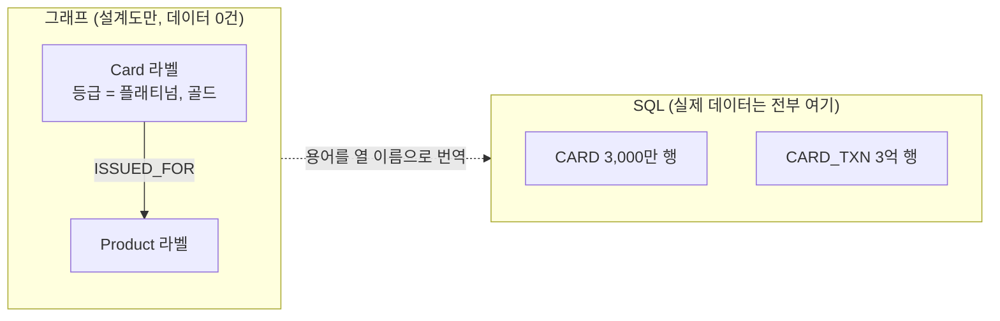
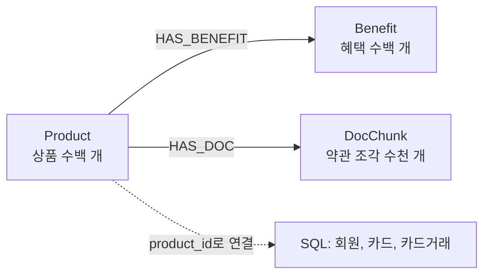
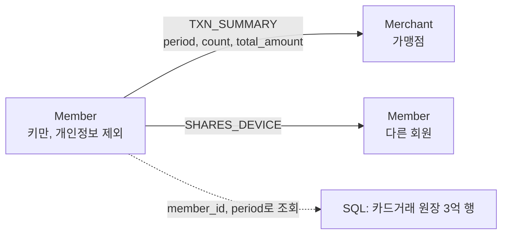
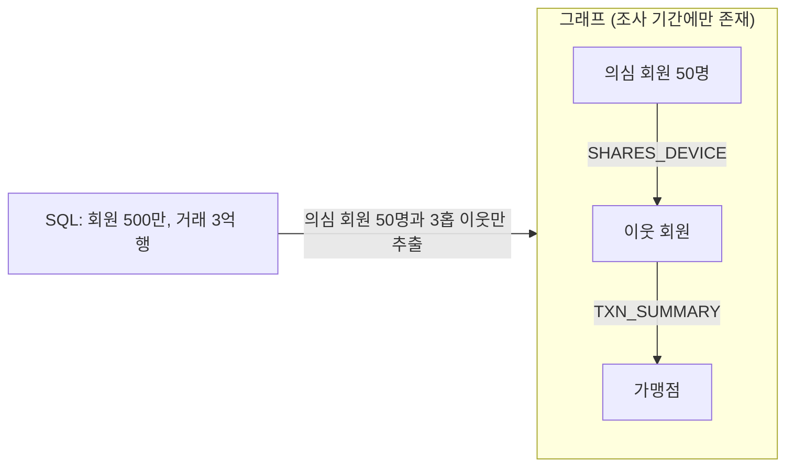
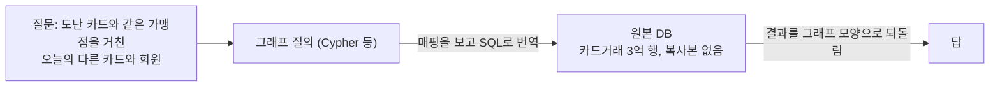
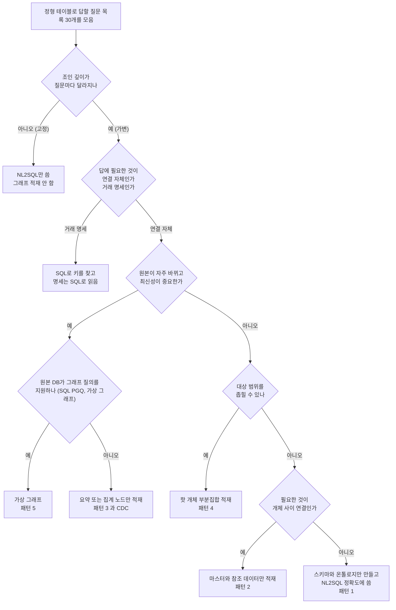

# 정형 데이터를 지식그래프로 구축하나 ~ 실무 조사와 실용 가이드

> 작성: 지식니(지식 데이터 엔지니어) | 작성일: 2026-10-18  
> 독자: Agentic AI 아키텍처 교육 수강생과 강사, 그래프 스키마 설계를 검토하는 사람,
> 인덱싱 파이프라인을 만들 개발자

## 질문 원문

<question>
'hybrid-ai-lab\prompts\design-graph-schema.md' 프롬프트는 정형테이블에서 KG스키마를 추출하는 것입니다.
근데 이렇게 스키마를 잘 추출하더라도, 테이블의 데이터를 KG에 구축하는건 데이터가 수억건일때는 불가능한 일입니다.
SQL검색기가 있다면 과연 정형 데이터를 KG로 구축하는게 의미가 있는지 계속 의구심이 듭니다.
실무에서는 정형데이터에 대해 KG를 진짜 구축하나요? 한다면 실용적인 가이드를 조사해 주세요.
</question>

## 한 눈에 보는 답

- 실무에서 정형 데이터로 지식그래프를 만듦. 다만 테이블 전체를 복사하지 않고, 목적에 맞는 가치 있는 개체와 개체 사이의 관계만 올림 [14][15][16][17]
- "수억 건이면 불가능"은 기술적으로는 틀림(수십억 엣지 사례 있음 [16]). 하지만 적재 도구가 요구하는 운영 조건이
  무거워서 "거래 원장 전부 복사"는 실무적으로 의미가 적음 [10][11]
- 2023년 이후 "복사하지 않는 그래프"가 표준과 제품으로 자리잡음. SQL:2023 SQL/PGQ, Spanner Graph,
  Oracle 23ai, Ontop, Neo4j Virtual Graph가 모두 원본 테이블을 그대로 두고 그래프로 질의함 [3][4][5][6][7][9]
- 지식그래프는 SQL 검색기를 대체하는 것이 아니라 정확도를 올림. 같은 DB에서 정답률 16% → 54%,
  온톨로지 검사를 더해 72%라는 측정이 있음 [1][2]
- 결론: 카드거래 수억 건은 SQL에 두고, 회원과 카드와 상품과 문서 같은 "연결의 뼈대"만 그래프로 올림(의견)

---

## 1장. 전제 검증 ~ "수억 건이면 KG 구축은 불가능"이 맞나

### 1-1. 먼저 알아야 할 용어

| 용어 | 쉬운 설명 |
|------|-----------|
| 노드(Node) | 그래프의 점 하나. 회원 1명, 상품 1개처럼 대상 하나를 뜻함(논문에서는 정점, vertex라고도 함) |
| 엣지(Edge) | 노드와 노드를 잇는 선. "회원이 카드를 가짐" 같은 관계 한 건(관계, relationship라고도 함) |
| 적재(Materialize) | 원본 데이터를 그래프DB 안에 실제로 복사해 넣는 일 |
| 가상 그래프(Virtual Graph) | 복사하지 않고, 그래프처럼 보이게만 해 두고 질문이 올 때 원본 DB에 물어보는 방식 |
| SQL/PGQ | 2023년 SQL 표준에 들어간 기능. 기존 테이블 위에 그래프를 "정의"하고 그래프 질의를 돌림 [5] |
| OBDA(Ontology Based Data Access) | 업무 용어 사전(온톨로지)과 테이블 열을 짝지어 두고, 용어로 질문하면 SQL로 번역해 주는 방식 [7][8] |
| 벌크 로더(Bulk Loader) | 대량 데이터를 그래프DB에 한 번에 밀어 넣는 전용 도구 [10][11] |
| CDC | 원본 DB가 바뀐 내용만 뽑아 따라 적용하는 증분 동기화 방식 |
| 마스터 데이터 | 회원, 상품, 가맹점처럼 자주 바뀌지 않고 여러 업무가 공통으로 쓰는 기준 정보 |

비유를 하나만 쓰자면, 복사형 그래프는 **도서관 책을 전부 옮겨 새 도서관을 짓는 일**이고,  
가상 그래프는 **원래 도서관은 그대로 두고 새 색인 카드만 만드는 일**임.

### 1-2. 기술적으로는 가능함 (Fact)

수억 건 규모 그래프는 이미 돌아가고 있음.

- Alibaba의 AliGraph 논문은 노드 4억 9,290만 개, 엣지 68억 2,000만 개를 가진 실제 데이터로 실험했다고 적음.
  이 시스템은 알리바바 전자상거래의 상품 추천과 개인화 검색에 실제 배치되어 있음 [16]
- Ant Group은 금융 업무 여러 곳에서 그래프 처리로 악성 행위와 금지 행위를 찾아내고 있으며, 큰 데이터 양과
  높은 처리량 아래에서 낮은 지연을 지키는 것이 과제라고 적음 [17]
- Amazon의 AutoKnow는 상품 지식그래프를 자동으로 모으는 시스템이며, 1만 1,000종이 넘는 상품 유형에서
  운영되어 왔다고 적음 [15]

즉 "수억 건이라 불가능"은 사실이 아님. 규모 자체는 해결된 문제임.

### 1-3. 어려운 것은 "처음 넣기"가 아니라 "계속 맞춰 두기"임

그래프를 만드는 일은 두 가지로 나뉨. 처음에 한 번 넣는 일과, 그 뒤로 바뀌는 내용을 매일 따라 넣는 일임.
실무에서 무거운 쪽은 뒤의 일임.

**처음 넣기 (Fact)**  
- Neo4j의 대량 적재 도구는 수십억 건까지 다루지만, 그래프DB를 잠시 멈출 수 있고 DB가 비어 있을 때 쓰는
  도구임. 곧 **최초 1회 적재용**임 [10]
- AWS Neptune도 대량 적재 전에 서버를 가장 큰 크기로 키웠다가 끝나면 다시 줄이라고 안내함.
  대량 적재는 평소 운영과 따로 치르는 큰 행사라는 뜻임 [11]

**계속 맞춰 두기 (Fact)**  
- 같은 Neo4j 문서는 대량 적재로 들어간 데이터를 변경 추적 기능(CDC)이 잡지 못한다고 적음 [10].
  빠르게 넣는 길과 바뀐 것만 따라 넣는 길이 따로 놀아서, 둘을 잇는 작업은 직접 만들어야 함

**카드거래로 보면 (의견)**  
- 처음 3억 건은 주말에 한 번 넣으면 끝남
- 다음 날부터 새 거래가 매일 쌓이고, 취소, 정정, 회원 탈퇴 같은 변경도 함께 생김
- 이것을 그래프에 빠짐없이 따라 넣지 못하면 SQL과 그래프가 서로 다른 답을 내기 시작함
- 같은 데이터를 두 곳에 두는 순간 "어느 쪽이 맞나"를 매일 확인하는 일이 새로 생김

그래서 물어야 할 것은 "넣을 수 있나"가 아니라 **"매일 맞춰 둘 만큼 가치가 있나"**임.

### 1-4. 전제 판정 (의견)

> **의견**: 질문의 전제를 두 조각으로 나누면 답이 선명해짐.
>
> - "수억 건을 그래프에 넣는 것이 기술적으로 불가능하다" → **틀림** [16][17]
> - "수억 건 거래 원장을 그래프로 복사해 계속 동기화하는 것이 실무적으로 합리적이다" → **대체로 아님** [10][11]
>
> 즉 의구심 자체는 정확한 지점을 짚고 있음. 다만 결론이 "그래프를 쓰지 말자"가 아니라
> "무엇을 올리고 무엇을 안 올릴지 정하자"로 가야 함.

---

## 2장. 실무에서는 정형 데이터로 무엇을 KG에 넣나 (Fact)

### 2-1. 사례에서 공통으로 보이는 것

공개된 1차 자료에서 확인한 사례를 보면, KG 구축 대상은 **목적에 맞는 가치 있는 개체(Entity)와 개체 사이의 관계**임.
아래 표처럼 사례마다 추천, 검색, 사기 탐지 같은 목적이 먼저 있고, 그 목적에 필요한 개체와 관계를 골라 올림.
거래 한 건 한 건을 전부 복사한다는 서술은 찾지 못함.

| 사례 | 무엇을 그래프로 올렸나 | 목적 | 출처 |
|------|------------------------|------|------|
| LinkedIn Knowledge Graph | 회원, 채용공고, 직함, 스킬, 회사, 지역, 학교 같은 **개체**와 그 사이 관계 | 검색, 추천, 광고, 분석에 신호 제공 | [14] |
| Amazon AutoKnow | 상품 분류체계, 상품 속성, 추출한 지식, 동의어 | 상품 검색과 질의응답 | [15] |
| Alibaba AliGraph | 노드 4억 9,290만 개, 엣지 68억 2,000만 개 규모의 속성 포함 그래프 | 상품 추천, 개인화 검색 | [16] |
| Ant Group | 금융 활동 그래프 | 악성 행위와 금지 행위 탐지 | [17] |

LinkedIn 글은 원본 데이터가 사용자 작성 내용과 인터넷 추출 내용이라 **잡음이 많고 중복이 있다**고 밝히고,
그래서 개체 분류체계 구성, 관계 추론, 데이터 표준화에 기계학습을 쓴다고 적음 [14].
이는 "RDB를 그대로 옮기면 끝"이 아니라 **개체 해소(같은 의미의 개체를 하나로 합치기)가 그래프 구축의 본체**라는 뜻임.  
예: 회원DB의 회원과 상담DB의 고객, 'OO마트 강남점'과 'OO마트(강남)'처럼 이름이나 시스템은 달라도 같은 대상인 경우.

### 2-2. Neo4j 공식 모델링 가이드가 말하는 변환 규칙 (Fact)

Neo4j 공식 시작 문서의 "관계형에서 그래프로" 가이드는 다음 변환 규칙을 제시함 [13].

- 테이블 → 노드 라벨, 행 → 노드, 열 → 노드 속성
- **업무상 의미가 있는 키만 남기고 기술적 기본 키는 지움**
- 외래 키 → 관계로 바꾸고 외래 키 열은 지움
- **기본값으로 채워진 데이터는 지움. 저장할 필요가 없음**
- 비정규화 테이블의 중복 데이터는 별도 노드로 빼서 모델을 정리함
- 조인 테이블 → 관계, 조인 테이블의 열 → 관계 속성

> 주목할 점: 공식 가이드조차 "전부 그대로 옮기라"가 아니라 **지우고 정리하라**를 반복해서 말함 [13].
> 즉 표준 절차 안에 이미 "범위를 줄인다"가 들어 있음.

---

## 3장. 복사하지 않는 그래프 ~ 2023년 이후의 실제 변화 (Fact)

이 장이 질문에 대한 가장 직접적인 답임. "그래프를 쓰려면 반드시 복사해야 한다"는 전제가 최근 몇 년 사이에 깨짐.

### 3-1. SQL 표준 안으로 들어온 그래프 질의

> **SQL/PGQ** = SQL Property Graph Queries(SQL 속성 그래프 질의). SQL 표준(ISO/IEC 9075)의 16부로 2023년에 추가됨 [19].  
> 기존 테이블을 노드와 엣지로 보도록 정의하고, SQL 안에서 그래프 패턴으로 질의하는 기능임.

- DuckPGQ 논문(CIDR 2023)은 **SQL:2023이 속성 그래프 질의(SQL/PGQ) 하위 언어를 도입**하며, 이로써 관계형
  시스템이 그래프 질의를 표준화할 기회를 얻는다고 적음 [5]
- Oracle Database 23ai부터 SQL 기반 인터페이스에서 SQL 속성 그래프를 만들고 질의할 수 있음.
  `CREATE PROPERTY GRAPH` DDL로 데이터베이스 안에 속성 그래프 **객체**를 만들고, `GRAPH_TABLE` 연산자로
  그래프 패턴 질의를 씀 [6]
- 같은 Oracle 문서는 **전체 그래프 또는 부분 그래프(subgraph)만** 그래프 서버(PGX) 메모리로 올릴 수 있다고
  적음 [6]. "필요한 부분만 올린다"가 제품 기능으로 들어가 있음

### 3-2. 클라우드 데이터베이스의 무이관 그래프

- Google Spanner Graph 공식 문서는 `CREATE PROPERTY GRAPH` 문으로 **테이블 또는 SQL 뷰에서** 그래프를 만들고,
  그래프를 만드는 데 쓰인 테이블을 **입력 테이블(input tables)**이라 부른다고 적음. 또한 Spanner Graph가
  SQL/PGQ를 쓴다고 명시함 [4]

> **GQL** = Graph Query Language(그래프 질의 언어). 2024년 4월 ISO/IEC 39075로 발행된 그래프 전용 국제 표준
> 질의 언어임 [20]. SQL/PGQ가 "SQL 안에서 쓰는 그래프 질의"라면, GQL은 그래프만을 위한 독립 언어임.

- Spanner Graph 개요 문서는 GQL과 SQL이 완전히 상호 운용되어 데이터 사일로를 없애며,
  **추출, 변환, 적재(ETL)에 따른 운영 부담 없이** 용도마다 알맞은 도구를 고를 수 있다고 적음 [3]

### 3-3. 업무 용어 사전(온톨로지)으로 원본 DB에 묻는 가상 지식그래프(OBDA)

| 약어 | 풀네임 | 쉬운 설명 |
|------|--------|-----------|
| OBDA | Ontology Based Data Access(온톨로지 기반 데이터 접근) | 업무 용어 사전과 테이블 열을 짝지어 두고, 용어로 원본 DB에 묻는 방식 [8] |
| RDF | Resource Description Framework(자원 기술 프레임워크) | "주어, 서술어, 목적어" 세 칸짜리 문장(트리플)으로 사실을 적는 W3C 표준 형식 [21] |
| SPARQL | SPARQL Protocol and RDF Query Language(RDF 질의 언어) | RDF 데이터에 묻는 표준 질의 언어. 약어 안에 자기 이름이 다시 들어 있는 재귀 약어임 [22] |

- Ontop 공식 문서는 Ontop을 "가상 지식그래프 시스템"이라 소개하며, **이 그래프는 가상이어서 데이터가 다른
  데이터베이스로 옮겨지지 않고 원래 데이터 소스에 그대로 남는다**고 적음. Ontop은 SPARQL 질의를 SQL로 번역해
  원본 관계형 DB에서 실행함 [7]
- Ontop 논문(Semantic Web Journal, 2017)은 가상 방식이 **적재 비용을 피하고**, 30년 넘게 성숙한 관계형
  시스템의 질의 처리와 보안과 트랜잭션 지원을 그대로 쓸 수 있다고 적음 [8]
- 같은 논문은 가상 RDF 그래프를 원하면 트리플로 적재할 수도 있다고 적음. 즉 **가상과 복사는 같은 설계에서
  고를 수 있는 두 가지 선택지**임 [8]

### 3-4. 그래프DB 벤더도 무이관 쪽으로 움직임

- Neo4j Aura 공식 문서의 Virtual Graph(공개 미리보기)는 **Cypher를 SQL로 번역해 Databricks나 Snowflake 같은
  데이터 레이크하우스로 질의를 보내는 가상 그래프 데이터베이스**라고 적음. 그리고 명시적으로
  **"데이터 레이크하우스에서 데이터를 옮기지도 추출하지도 않는다"**고 적음 [9]
- 같은 문서는 Virtual Graph가 세 단계로 동작한다고 적음 [9]
  1. 데이터 레이크하우스에 연결함
  2. **데이터에서 찾은 테이블을 바탕으로 그래프 스키마를 만듦**
  3. Cypher를 최적화된 SQL로 번역하고 결과를 그래프 데이터로 받음

### 3-5. 복사 여부 비교표 (Fact)

| 방식 | 원본 테이블을 복사하나 | 질의 언어 | 확인된 근거 |
|------|------------------------|-----------|-------------|
| SQL/PGQ (SQL:2023) | 복사하지 않음. 테이블 위에 그래프를 정의함 | SQL + 그래프 패턴 | [5] |
| Oracle Database 23ai 속성 그래프 | DB 안에 그래프 객체를 정의함. PGX로는 전체 또는 일부만 메모리 적재 | `GRAPH_TABLE`, PGQL | [6] |
| Google Spanner Graph | 복사하지 않음. 입력 테이블 또는 뷰에서 그래프를 만듦. ETL 운영 부담 없음 | GQL + SQL | [3][4] |
| Ontop (가상 지식그래프, OBDA) | 복사하지 않음. 데이터가 원본에 남음. 원하면 적재도 가능 | SPARQL → SQL 번역 | [7][8] |
| Neo4j Aura Virtual Graph | 복사하지 않음. 데이터를 옮기지도 추출하지도 않음 | Cypher → SQL 번역 | [9] |
| **Apache AGE** | **복사함.** 그래프마다 전용 네임스페이스에 꼭짓점과 엣지 전용 테이블을 만들어 저장함 | openCypher + SQL | [12] |
| Neo4j 일반 적재 | 복사함. 벌크 로더는 비어 있는 DB와 오프라인 작업을 전제로 함 | Cypher | [10] |
| Amazon Neptune 벌크 로더 | 복사함. S3 파일을 읽어 적재함 | Gremlin, openCypher, SPARQL | [11] |

> **주의할 함정**: "PostgreSQL 안에서 그래프를 쓰니 복사가 아니다"라고 오해하기 쉬움.
> Apache AGE는 PostgreSQL 확장이지만 그래프 데이터를 **자기 전용 테이블에 따로 저장**함 [12].
> 같은 DB 안에 있을 뿐, 원본 업무 테이블과는 별개의 복사본임. SQL/PGQ와 성격이 다름 [5].

---

## 4장. 지식그래프가 NL2SQL을 돕는 방식 (Fact)

"SQL 검색기가 있으면 그래프가 필요 없다"는 생각을 정면으로 다루는 측정이 있음.

### 4-1. 수치

data.world 연구진이 만든 벤치마크의 결과임.

| 조건 | 정답률 | 출처 |
|------|--------|------|
| GPT-4가 SQL 데이터베이스에 바로 질의(zero-shot Text-to-SQL) | **16%** | [1] |
| 같은 질문을 같은 DB의 **지식그래프 표현** 위에서 질의(Text-to-SPARQL) | **54%** | [1] |
| 위에 더해 온톨로지 기반 질의 검사(OBQC)와 LLM 수정까지 적용 | **72%**(모르겠다 8% 포함, 오답률 20%) | [2] |

벤치마크 구성은 보험 도메인의 기업용 SQL 스키마, 보고부터 지표까지 아우르는 기업 질의 모음,
그리고 **온톨로지와 매핑으로 이루어진 맥락 계층(contextual layer)**임 [1].

### 4-2. 이 수치를 읽는 법 (Fact와 의견 구분)

- (Fact) 후속 논문이 밝힌 개선 원리는 "LLM이 만든 SPARQL이 **틀린 경로를 따라간다**"는 관찰이었고,
  온톨로지로 그 경로가 의미상 맞는지 검사해 틀리면 설명과 함께 다시 고치게 한 것임 [2]
- (Fact) 두 논문 모두 **같은 저자 그룹(data.world)**의 자체 벤치마크임 [1][2]
- (의견) 그래서 "16%와 54%"를 일반 법칙으로 쓰면 안 됨. 대신 이 연구가 보여 주는 **구조**가 중요함.
  지식그래프가 한 일은 데이터를 복사한 것이 아니라 **"이 회사에서 이 말이 무슨 뜻이고 무엇과 이어지는가"를
  적어 둔 것**임. 이는 데이터 양과 무관하게 스키마와 온톨로지 쪽 작업임
- (의견) 따라서 **"KG 구축 = 수억 건 복사"라는 등식 자체가 성립하지 않음.**
  위 벤치마크에서 정확도를 올린 재료는 테이블의 행이 아니라 온톨로지와 매핑이었음 [1]

### 4-3. 프로젝트 관점의 함의 (의견)

> **의견**: 정형 데이터에서 그래프 스키마를 뽑는 작업은 "적재 준비"가 아니라 그 자체로 **의미 계층 자산**임.
> Neo4j Virtual Graph도 두 번째 단계가 "테이블을 바탕으로 그래프 스키마를 만듦"임 [9].
> 즉 복사를 하든 안 하든 스키마 설계는 공통으로 필요함.

---

## 5장. 판단 기준과 결정 순서도 (의견)

> **이 장 전체는 「의견」임.** 앞 장의 사실을 바탕으로 지식니가 정리한 판단 기준이며,
> 특정 논문이 제시한 판정표가 아님.

### 5-1. SQL로 충분한 질문과 그래프가 필요한 질문

| 구분 | 특징 | 대표 질문 | 권장 경로 |
|------|------|-----------|-----------|
| 집계와 필터 | 한 테이블 또는 2 ~ 3개 조인으로 끝남. 답이 숫자 | "지난달 카드별 결제 합계" | NL2SQL |
| 조건 조회 | 키를 알고 행을 읽어 옴 | "이 회원의 보유 카드 목록" | NL2SQL |
| 다단 연결(3홉 이상) | 조인을 거듭해야 하고 깊이가 질문마다 달라짐 | "이 회원과 기기를 공유한 회원이 쓴 가맹점" | KG(연결 탐색) |
| 경로와 연결성 | 최단 경로, 고리(ring), 군집 찾기 | "이 계좌에서 저 계좌까지 자금이 흘러간 경로" | KG(경로 탐색) |
| 서로 다른 시스템의 개체 연결 | 회원DB, 상담DB, 외부 명부에서 같은 의미의 개체(같은 사람, 같은 가맹점 등) 찾기 | "이 사람과 동일인으로 보이는 계정" | KG(개체 해소) |
| 정형과 비정형 잇기 | 테이블의 상품과 PDF 약관 문단을 잇기 | "이 카드 혜택 조항의 근거 문서는?" | KG + 벡터 |
| 전체 요약 | 자료 전체를 관통하는 주제 | "이 분야 상담에서 반복되는 불만은?" | KG(묶음 요약) |

표의 KG는 모두 같은 지식그래프 하나임. KG에는 테이블에서 옮긴 개체와 문서에서 뽑은 개체가 함께 들어감.
괄호는 KG를 쓰는 방법만 나타냄. 연결 탐색과 경로 탐색은 Cypher로 연결을 따라가 정확한 목록을 돌려주고,
묶음 요약은 서로 빽빽하게 이어진 개체 묶음마다 요약을 만들어 두었다가 전체를 묻는 질문에 씀
(Microsoft GraphRAG가 이 방식임 [23]).

판단 한 줄: **조인 깊이가 질문마다 달라지면 KG, 고정되어 있으면 SQL.**

### 5-2. 적재 범위 선택 패턴 5가지

그래프에 무엇을 넣을지 정하는 방법은 크게 다섯 가지임. 먼저 표로 한눈에 보고, 아래에서 업무 장면으로 풀어 씀.

| 패턴 | 무엇을 올리나 | 언제 고르나 | 비용 | 한 줄 비유 |
|------|---------------|-------------|------|------------|
| ① 스키마만 올림 | 노드 타입, 관계, 온톨로지. 데이터는 안 올림 | NL2SQL 정확도가 목적일 때 | 매우 낮음 | 메뉴판만 걺 |
| ② 마스터와 참조 데이터만 | 회원, 상품, 가맹점, 분류체계. 거래는 제외 | 개체 해소와 추천이 목적일 때 | 낮음 | 주소록만 옮김 |
| ③ 요약 또는 집계 노드 | "이 회원이 이 가맹점에서 N회, 합계 M원"으로 압축 | 거래가 만든 연결만 필요할 때 | 중간 | 영수증 대신 합계표 |
| ④ 핫 개체 부분집합 | 최근 90일, 위험 점수 상위, 조사 대상만 | 대상이 좁고 깊게 보는 일 | 중간 | 수사 보드에만 붙임 |
| ⑤ 가상 그래프 | 아무것도 안 올리고 질의 때 원본에 물어봄 | 원본이 자주 바뀌고 전체가 필요할 때 | 낮음(질의 때 높음) | 색인 카드만 만듦 |

**집계 엣지**는 거래 여러 건을 "몇 번, 얼마"처럼 한 줄로 묶어 만든 선임.  
노드, 엣지, 적재, 가상 그래프, CDC, 마스터 데이터는 1-1 용어표 참조.

#### 5-2-1. 패턴 ① 스키마만 올림

**이런 상황이면**  
데이터 분석팀 박 대리가 사내 챗봇에 "지난달 플래티넘 등급 신규 발급 건수"라고 물음.
그런데 테이블에는 `CRD_GRD_CD`라는 열만 있고 '플래티넘'이라는 말이 없어서, 질문을 SQL로 바꿔 주는
기능이 엉뚱한 열을 골라 0건을 돌려줌. 이때 데이터는 한 줄도 옮기지 않고
"플래티넘 = `CRD_GRD_CD`가 'P'인 카드"라는 말뜻 사전, 곧 온톨로지(업무 용어와 그 관계를 적은 사전)만 만듦.

**그래프에 실제로 들어가는 것**  
노드 타입과 관계 타입의 설계도만 들어감. 행 데이터는 0건임.

**질문이 처리되는 흐름**
1. 질문에서 '플래티넘', '신규 발급' 같은 업무 용어를 뽑음
2. 그래프에 적힌 온톨로지에서 그 용어가 어느 테이블의 어느 열인지 찾음
3. 찾은 열로 SQL을 만들고 원본 DB에서 실행함

**규모 감각**  
카드거래 3억 행과 회원 수백만 행은 전부 SQL에 남고 그래프 적재 행은 0건임. 생기는 것은 라벨과 관계 정의 수십 개뿐임(어림값).
같은 DB에서 그래프 표현과 온톨로지 검사를 더해 정답률이 16%에서 54%, 다시 72%로 오른 측정이 있음 [1][2].

**이럴 때는 맞지 않음**
- 3홉(점을 세 번 건너뛰는 일) 이상 연결을 따라가는 질문. 그래프에 데이터가 없어 답을 못 냄
- 같은 의미의 개체가 여러 시스템에 흩어져 있어 하나로 합쳐야 하는 일(개체 해소). 이것은 데이터가 있어야 함

#### 5-2-2. 패턴 ② 마스터와 참조 데이터만

**이런 상황이면**  
상품기획팀 김 과장이 "이 카드의 연회비 면제 조건과 관련된 약관 조항을 모두 보여 줘"라고 물음. 답이 상품
테이블 한 줄과 약관 PDF 문단에 나뉘어 있어 반쪽임. 그래서 자주 바뀌지 않는 상품, 혜택, 약관 조각만 이어 둠.

**그래프에 실제로 들어가는 것**  
상품, 혜택, 상품 문서 조각, 상담 분류처럼 수가 적고 오래 유지되는 개체만 올림.
회원, 카드, 거래는 SQL에 그대로 둠.

**질문이 처리되는 흐름**
1. 질문에 나온 카드 이름으로 그래프에서 `Product` 노드를 찾음
2. `HAS_BENEFIT`과 `HAS_DOC`을 따라가 관련 약관 조각을 모음
3. 모은 조각을 근거로 답을 만들고, 금액이나 건수가 필요하면 `product_id`로 SQL을 한 번 더 호출함

**규모 감각**  
상품 수백 개에 약관 조각 수천 개, 상담 분류 수십 개를 더해도 노드는 1만 개 미만임(어림값).
카드거래 3억 행과 견주면 1만분의 1보다도 작은 규모라, 한 번 올리고 상품 개편 때만 갱신하면 됨.

**이럴 때는 맞지 않음**
- "지난달 결제 합계" 같은 금액 집계. 거래가 그래프에 없고, 있어도 집계는 SQL이 더 빠르고 정확함
- 회원 사이 연결을 묻는 사기 조사. 회원과 거래가 없으므로 답이 안 나옴

#### 5-2-3. 패턴 ③ 요약 또는 집계 노드

**이런 상황이면**  
이상거래탐지팀 이 차장이 "이 회원과 같은 기기를 쓴 다른 회원들이 최근 많이 간 가맹점"을 물음. 답에 필요한
것은 건별 승인 번호가 아니라 "회원과 가맹점이 이어져 있다"는 사실이라, (회원, 가맹점, 기간)마다 한 줄로 묶음.

**그래프에 실제로 들어가는 것**  
회원과 카드는 키만, 가맹점은 노드로, 거래는 집계 엣지 `TXN_SUMMARY` 하나로 압축함.

압축 엣지의 모양은 6장과 같음.  
`(:Member)-[:TXN_SUMMARY {period, count, total_amount, last_txn_date}]->(:Merchant)`

**질문이 처리되는 흐름**
1. SQL에서 질문에 나온 회원의 `member_id`를 찾음
2. 그래프에서 `SHARES_DEVICE`를 따라 같은 기기를 쓴 회원들을 모음
3. 그 회원들의 `TXN_SUMMARY` 엣지를 모아 `count` 합이 큰 가맹점 순으로 뽑음
4. 거래 명세 원문이 필요하면 `member_id`와 `merchant_id`와 `period`로 SQL을 한 번 더 호출함

**규모 감각**  
아래는 가정을 세운 어림값이며, 실제 분포로 다시 계산해야 하는 수임(출처 없음).
- 가정: 카드거래 3억 건이 3개월치, 회원 500만 명, 한 회원이 한 분기에 거래한 서로 다른 가맹점 20곳
- (회원, 가맹점, 분기)로 묶으면 엣지는 약 1억 개. 3억에서 1억이니 약 3배 줄어듦
- "같은 가맹점에서 3회 이상"을 더해 회원당 5곳만 남기면 약 2,500만 개로 약 12배 줄어듦
- 즉 압축 효과는 기간을 어떻게 묶고 어떤 조건을 거느냐에 크게 좌우됨. 묶는 규칙을 먼저 정해야 함

**이럴 때는 맞지 않음**
- "이 거래 건의 승인 내역 원문"처럼 건별 상세가 답인 질문. 압축 과정에서 사라진 정보임
- 묶어도 여전히 수억 개가 남는 경우. 이때는 패턴 ④로 범위를 좁히거나 패턴 ⑤로 넘어감
- 증분 동기화 설계가 없는 경우. 벌크 적재는 빈 DB와 오프라인을 전제하고 CDC가 그 결과를 못 잡음 [10]

#### 5-2-4. 패턴 ④ 핫 개체 부분집합

**이런 상황이면**  
사기조사팀 최 과장에게 이번 주 신고된 의심 회원 50명 목록이 내려옴. "이 50명 주변을 3홉까지 펼쳐 보여 줘"가
요청인데 전체 회원 500만 명을 올릴 이유는 없음. 그래서 조사 대상과 주변만 올리고 조사가 끝나면 비움.
가상의 예로, 보험사가 특정 병원과 엮인 청구 건만 뽑아 조사 기간에만 그래프로 보는 경우도 같은 패턴임.

**그래프에 실제로 들어가는 것**  
조사 대상 회원과 그 이웃만 올림. 나머지 회원과 전체 거래 원장은 SQL에 그대로 둠.

**질문이 처리되는 흐름**
1. 조사 대상 목록(회원 50명)을 받아 SQL로 3홉 이내 관련 행만 뽑음
2. 뽑은 부분만 그래프에 올림
3. 그래프에서 경로와 고리를 찾아 조사 결과를 냄. 조사가 끝나면 이 그래프를 비움

**규모 감각**  
아래는 가정을 세운 어림값임(출처 없음).
- 가정: 의심 회원 50명, 한 명당 3홉 이내 이웃이 평균 2,000개
- 노드는 약 10만 개. 전체 500만 명의 50분의 1 수준이라 한 번에 메모리에 올려 두고 깊게 볼 수 있음
- Oracle도 전체 그래프뿐 아니라 부분 그래프만 그래프 서버 메모리에 올리는 기능을 제공함 [6]

**이럴 때는 맞지 않음**
- 전체 회원을 대상으로 상시 돌아가는 추천이나 검색. 대상 목록을 미리 정할 수 없음
- 조사 대상을 고르는 기준 자체가 연결 분석에서 나오는 경우. 올리기 전에 이미 그래프가 필요해짐

#### 5-2-5. 패턴 ⑤ 가상 그래프

**이런 상황이면**  
리스크팀 정 부장이 "방금 도난 신고된 카드가 오늘 결제한 가맹점에서, 같은 날 결제한 다른 카드와 그 회원"을 물음.
카드 → 가맹점 → 다른 카드 → 회원으로 세 번 건너가야 하는 질문이고, '오늘'이 답의 핵심이라 하루 전 복사본은
쓸모가 없음. 이때는 아무것도 복사하지 않고 원본 DB에 그래프 모양으로 질문을 던짐.  
참고로 "오늘 가맹점별 결제 카드 수"처럼 한 번 묶어 세면 끝나는 질문은 그래프가 아니라 SQL `GROUP BY`로 충분함.

**그래프에 실제로 들어가는 것**  
데이터는 0건임. 들어가는 것은 "어느 테이블의 어느 열이 어느 노드와 엣지인가"라는 매핑뿐임.

**질문이 처리되는 흐름**
1. 질문을 그래프 질의로 바꿈
2. 매핑을 보고 그 질의를 SQL로 번역해 원본 DB에서 실행함
3. 돌아온 행을 노드와 엣지 모양으로 되돌려 답을 만듦

**규모 감각**  
복사되는 행은 0건이고 동기화 작업도 없음. 대신 질의 1건이 여러 개의 SQL로 번역되어 원본 DB에 부하가 감.
Neo4j Aura Virtual Graph는 Cypher를 최적화된 SQL로 번역하며 데이터를 옮기지도 추출하지도 않는다고 적음 [9].
Spanner Graph는 입력 테이블이나 뷰에서 그래프를 만들어 ETL 운영 부담이 없다고 적고 [3][4],
Ontop은 SPARQL을 SQL로 번역해 데이터가 원본에 남는다고 적음 [7]. SQL:2023의 SQL/PGQ도 같은 방향임 [5].

**이럴 때는 맞지 않음**
- 원본 DB가 그래프 질의를 지원하지 않는 경우. 제품이 되는지부터 확인해야 함
- 업무용 원본 DB에 분석 부하를 걸면 안 되는 경우. 번역된 SQL이 그대로 원본으로 감
- 홉 수가 깊고 가변인 경로 탐색. 조인이 쌓여 응답 시간이 나빠질 수 있음(수억 건 규모 실측 자료는 찾지 못함, 문서 끝 참조)

#### 5-2-6. 패턴은 섞어 씀

다섯 패턴은 택일 문제가 아니라 데이터 종류마다 따로 고르는 선택지임.
6장의 카드사 권장안도 두 패턴 이상을 겹쳐 씀.

| 구성 | 쓰는 패턴 | 어떻게 겹치나 |
|------|-----------|---------------|
| 기본안 | ① + ② | 스키마와 온톨로지를 만들고(①), 상품과 상품 문서와 상담 분류만 올림(②) |
| 확장안 | ② + ③ | 회원과 카드는 키만, 가맹점은 노드로 올리고(②), 거래는 `TXN_SUMMARY`로 압축함(③) |

기본안이 회원과 카드와 카드거래를 올리지 않는 이유는, SQL로 키를 찾아 그 키로 그래프를 조회하면 개인정보와
동기화 부담을 함께 피하기 때문임(6-2 참조). 확장안의 패턴 ③이 "수억 건이면 불가능하지 않나"를 직접 푸는 수임.
거래 3억 건을 그대로 올리는 대신 "회원 ~ 가맹점" 연결만 남기고, 명세가 필요하면 그때 SQL로 내려감.
대상이 좁아지면 여기에 패턴 ④를 얹고, 최신성이 핵심인 질문만 패턴 ⑤로 돌리면 됨.

### 5-3. 결정 순서도

### 5-4. 비용을 먼저 계산하는 3줄 산식

1. 올릴 노드 수와 엣지 수를 센다(테이블 행 수가 아니라 **압축 후** 수)
2. 벌크 적재는 DB를 내려야 하고 비어 있는 DB를 전제한다는 점을 일정에 반영한다 [10]
3. 적재 후 매일 들어오는 증분 건수를 센다. CDC가 벌크 적재 결과를 잡지 못한다는 제약을 확인한다 [10]

3번에서 답이 안 나오면 패턴 ⑤(가상 그래프)로 되돌아가는 것이 정석임.

---

## 6장. 카드사 예제에 적용한 권장안 (의견)

> **이 장 전체는 「의견」임.**

### 6-1. 데이터 현황

| 테이블 | 대략 규모 | 성격 |
|--------|-----------|------|
| 회원 | 수백만 | 마스터 |
| 카드 | 수백만에서 수천만 | 마스터 |
| 상품 | 수백 | 참조 |
| 상품 문서 | 수천 | 비정형 |
| 상담 | 수천만 | 반정형(텍스트 포함) |
| 카드거래 | **수억** | 거래 원장 |

### 6-2. 권장 구성

권장 구성은 두 단계로 나눔. 기본안은 이 프로젝트가 2026-10-14에 정한 방향
("SQL로 키를 찾고 그 키로 그래프를 조회")과 같고, 확장안은 연결 분석 질문이 실제로 생겼을 때만 더함.

**기본안 ~ 연결 고리만 올림**

| 데이터 | 그래프에 올리나 | 이유 |
|--------|------------------|------|
| 상품 | 올림(노드) | 수가 적고 문서와 이어야 함 |
| 상품 문서 조각 | 올림(노드 + 벡터) | 정형과 비정형을 잇는 자리 |
| 상담 | 키와 분류만 올림 | 본문은 벡터 인덱스에 둠 |
| 회원, 카드 | 올리지 않음 | SQL로 회원의 상품ID(키)를 찾아 그래프 조회에 넘김. 개인정보와 동기화 부담을 피함 |
| **카드거래** | **올리지 않음** | 수억 건 복사와 동기화 부담을 피함 |

**확장안 ~ 사기 탐지처럼 "회원 사이 연결"을 묻는 질문이 생길 때**

| 데이터 | 그래프에 올리나 | 이유 |
|--------|------------------|------|
| 회원, 카드 | 키만 올림(개인 속성 제외) | 개체 해소와 연결의 출발점 |
| 가맹점 | 올림(노드) | 거래를 압축할 때 반대편 개체로 필요 |
| 카드거래 | "회원 ~ 가맹점" 집계 엣지 1개로 압축 | 원장 복사 대신 연결만 남김(패턴 ③) |

압축 엣지 예시: `(:Member)-[:TXN_SUMMARY {period, count, total_amount, last_txn_date}]->(:Merchant)`  
원래 거래 명세가 필요하면 `member_id`와 `merchant_id`와 `period`로 SQL을 한 번 더 호출함.

### 6-3. 질문별 경로 배정

| 질문 | 경로 | 이유 |
|------|------|------|
| "지난달 내 카드 결제 합계는?" | NL2SQL | 집계 하나로 끝남 |
| "이 상품 연회비 면제 조건은?" | 벡터 RAG | 문서 한두 구절에 답이 있음 |
| "이 상품과 비슷한 혜택 상품은?" | KG + 벡터 | 상품 ~ 혜택 ~ 상품 연결 |
| "이 회원과 같은 기기를 쓴 다른 회원들이 최근 많이 간 가맹점은?" | KG(확장안) | 3홉 이상 가변 깊이 |
| "이 거래 건의 승인 내역 원문은?" | NL2SQL | KG에 없음. 키로 SQL 조회 |
| "상담에서 반복되는 불만 주제는?" | KG(묶음 요약) | 전체를 묻는 질문 |

### 6-4. 하지 말 것

- 카드거래 테이블을 통째로 Neo4j에 복사하기. 적재 도구가 오프라인과 빈 DB를 전제하고,
  CDC가 그 결과를 못 잡음 [10]
- 그래프에 넣었다는 이유로 SQL 경로를 없애기. 금액 집계는 SQL이 정답임
- 외래 키를 전부 관계로 바꾼 뒤 그대로 두기. 공식 가이드도 기술적 기본 키와 기본값 데이터를 지우라고 함 [13]

---

## 7장. 현재 스키마 설계 프롬프트에 대한 의견 (Opinion)

대상 파일: `hybrid-ai-lab/prompts/design-graph-schema.md` [18]

### 7-1. 여전히 쓸모 있음 ~ 근거 3가지

1. **적재를 하든 안 하든 스키마는 필요함.** Neo4j Virtual Graph도 두 번째 단계가
   "테이블을 바탕으로 그래프 스키마를 만듦"이고, Spanner Graph도 입력 테이블에서 그래프를 정의함 [4][9].
   복사하지 않는 길을 골라도 이 프롬프트의 산출물이 그대로 입력이 됨
2. **스키마와 온톨로지 자체가 NL2SQL 정확도를 올리는 재료임.** 벤치마크에서 정확도를 올린 것은
   행 데이터가 아니라 온톨로지와 매핑이었음 [1][2]
3. **사람의 판단을 기록으로 남김.** 규칙 ① 판정, 이름, 관계 방향을 `decisions.json`으로 남기는 설계는
   나중에 적재 범위를 바꿔도 재사용됨

### 7-2. 보완 제안: 적재 범위는 인덱싱 설정에서 정함 (의견. 파일은 고치지 않음)

이 프로젝트는 2026-10-14에 "스키마 설계 프롬프트는 구조만 옮기고, 실제로 무엇을 넣을지는 인덱싱 프로그램에서 정함"으로
결정했음. 이 결정은 이번 조사 결과와 맞음. 스키마는 복사형과 가상형 모두에 쓰이는 공통 설계도이고,
적재 범위는 질문 유형과 동기화 비용에 따라 바뀌는 운영 결정이기 때문임. 그래서 보완은 프롬프트가 아니라
인덱싱 쪽 설정 파일(예: `load_scope.yaml`)에 둠.

| 제안 | 내용 | 근거 |
|------|------|------|
| 가) 노드 타입별 적재 범위 | 인덱싱 설정에서 노드 타입마다 전체 / 요약 / 제외 / 가상 중 하나를 고름 | 5-2 패턴표 |
| 나) 행 수 확인 | 인덱싱 시작 전에 원본 테이블 행 수를 세고, 임계값(예: 1,000만 행)을 넘는 "전체" 설정이 있으면 멈추고 사람에게 확인함 | [10][11] |
| 다) 집계 엣지 정의 | 거래 테이블은 "전체" 대신 `TXN_SUMMARY` 같은 집계 엣지로 줄이는 변환 규칙을 인덱싱 설정에 둠 | 6-2 |
| 라) 가상 그래프 경로 | 같은 `graph_schema.json`을 가상 그래프(Neo4j Virtual Graph, SQL/PGQ 등)의 입력으로도 쓸 수 있음을 인덱싱 설계서에 적음 | [3][7][9] |

> **의견**: 스키마 프롬프트는 지금처럼 "구조를 정확히 옮기는 일"에 집중하는 편이 나음.
> 집계 엣지처럼 원본 테이블에 없는 관계 타입을 쓰려면, 인덱싱 설정에서 그 관계 타입을 스키마에 덧붙이는 절차를 따로 둠.

---

## 8장. 흔한 실패 5가지 (의견)

1. **"그래프니까 전부 넣는다"** ~ 공식 모델링 가이드조차 지우라는 항목이 더 많음 [13]
2. **개체 해소를 건너뛴다** ~ 같은 의미의 개체가 여러 노드로 흩어지면 연결이 안 보임.
   LinkedIn이 기계학습까지 동원한 지점이 여기임 [14]
3. **동기화 설계를 나중으로 미룬다** ~ 벌크 적재와 CDC가 맞물리지 않는다는 제약은 적재 후에 발견하면 늦음 [10]
4. **같은 DB 안이라 복사가 아니라고 착각한다** ~ Apache AGE는 전용 테이블에 따로 저장함 [12]
5. **SQL 경로를 없앤다** ~ 금액 집계와 명세 조회는 SQL이 정답이며, 그래프는 키를 찾아 주는 역할이 더 어울림

---

## 9장. 참고 출처

원문 확인 여부를 각 항목에 적음.

1. A Benchmark to Understand the Role of Knowledge Graphs on Large Language Model's Accuracy for
   Question Answering on Enterprise SQL Databases, Juan Sequeda, Dean Allemang, Bryon Jacob (data.world),
   arXiv:2311.07509, 2023년 11월 13일 제출, https://arxiv.org/abs/2311.07509 ~ **원문(초록) 직접 확인**
2. Increasing the LLM Accuracy for Question Answering: Ontologies to the Rescue!, Dean Allemang,
   Juan Sequeda, arXiv:2405.11706, 2024년 5월 20일 제출, https://arxiv.org/abs/2405.11706
   ~ **원문(초록) 직접 확인**
3. Spanner Graph overview, Google Cloud 공식 문서, 2026년 10월 13일 갱신,
   https://cloud.google.com/spanner/docs/graph/overview ~ **원문 직접 확인**
4. Spanner Graph schema overview, Google Cloud 공식 문서,
   https://cloud.google.com/spanner/docs/graph/schema-overview ~ **원문 직접 확인**
5. DuckPGQ: Efficient Property Graph Queries in an Analytical RDBMS, Daniel ten Wolde, Tavneet Singh,
   Gábor Szárnyas, Peter Boncz, CIDR 2023, https://duckdb.org/library/duckpgq ~ **원문(초록) 직접 확인**
6. SQL Property Graphs / SQL DDL Statements for Property Graphs, Oracle Database 25.1 공식 문서,
   https://docs.oracle.com/en/database/oracle/property-graph/25.1/spgdg/sql-property-graphs.html
   ~ **원문 직접 확인**
7. Introduction, Ontop 공식 문서(가상 지식그래프 시스템), https://ontop-vkg.org/guide/
   ~ **원문 직접 확인**
8. Ontop: Answering SPARQL Queries over Relational Databases, Diego Calvanese 외, Semantic Web Journal
   8(3), 2017, https://www.semantic-web-journal.net/system/files/swj1004.pdf ~ **원문(PDF) 직접 확인**
9. Virtual Graph (Public Preview), Neo4j Aura 공식 문서, https://neo4j.com/docs/aura/virtual-graph/
   ~ **원문 직접 확인**
10. Import (neo4j-admin database import), Neo4j Operations Manual 공식 문서,
    https://neo4j.com/docs/operations-manual/current/tools/neo4j-admin/neo4j-admin-import/
    ~ **원문 직접 확인**
11. Optimizing an Amazon Neptune bulk load, AWS 공식 문서,
    https://docs.aws.amazon.com/neptune/latest/userguide/bulk-load-optimize.html ~ **원문 직접 확인**
12. Overview / Graphs, Apache AGE 공식 문서,
    https://age.apache.org/age-manual/master/intro/graphs.html ~ **원문 직접 확인**
13. Modeling: relational to graph, Neo4j Getting Started 공식 문서,
    https://neo4j.com/docs/getting-started/data-modeling/relational-to-graph-modeling/
    ~ **원문 직접 확인**
14. Building The LinkedIn Knowledge Graph, Qi He, Bee-Chung Chen, Deepak Agarwal, LinkedIn Engineering
    Blog, 2016년 10월 6일,
    https://engineering.linkedin.com/blog/2016/10/building-the-linkedin-knowledge-graph
    ~ **원문 직접 확인**
15. AutoKnow: Self-Driving Knowledge Collection for Products of Thousands of Types, Xin Luna Dong 외
    (Amazon), KDD 2020, arXiv:2006.13473, https://arxiv.org/abs/2006.13473 ~ **원문(초록) 직접 확인**
16. AliGraph: A Comprehensive Graph Neural Network Platform, Rong Zhu 외(Alibaba), arXiv:1902.08730,
    https://arxiv.org/abs/1902.08730 ~ **원문(초록) 직접 확인**
17. Taking the Pulse of Financial Activities with Online Graph Processing, Xiaowei Zhu 외(Ant Group),
    SIGOPS Operating Systems Review, 2021년 6월,
    https://pacman.cs.tsinghua.edu.cn/~cwg/publication/financial-2021/ ~ **초록만 확인(저자 공개 페이지)**
18. (프로젝트 내부 파일) `hybrid-ai-lab/prompts/design-graph-schema.md`
19. ISO/IEC 9075-16:2023, Part 16: SQL Property Graph Queries (SQL/PGQ), https://www.iso.org/standard/79473.html  
    ~ **2차 출처 확인**(ISO 페이지는 접속 차단, 표준 이름은 https://en.wikipedia.org/wiki/Graph_Query_Language 인용 정보로 확인)
20. Graph Query Language(GQL), 위키백과, https://en.wikipedia.org/wiki/Graph_Query_Language  
    ~ **2차 출처**(ISO/IEC 39075:2024 발행 사실과 정식 명칭 확인)
21. RDF 1.1 Concepts and Abstract Syntax, W3C 권고안, https://www.w3.org/TR/rdf11-concepts/ ~ **원문 직접 확인**
22. SPARQL, 위키백과, https://en.wikipedia.org/wiki/SPARQL ~ **2차 출처**(재귀 약어 풀네임 확인)
23. From Local to Global: A Graph RAG Approach to Query-Focused Summarization, Darren Edge 외(Microsoft),
    https://arxiv.org/abs/2404.16130 ~ **원문 초록 직접 확인**(개체 묶음별 요약을 만들어 전체 질문에 답함)

---

## Fact와 Opinion 구분 안내

- **Fact**: 문장 끝에 `[번호]`가 붙은 내용임. 9장 목록의 1차 출처(논문 원문, 공식 문서, 공식 블로그)에서
  직접 확인한 사실과 수치만 적음
- **Opinion**: 「의견」이라고 표시한 단락과 5장, 6장, 7장, 8장 전체임. 지식니의 판단이며 특정 출처가
  보증하지 않음
- **적지 않은 것**: 원문을 열지 못한 사례 수치, 커뮤니티 게시글의 적재 시간, 출처 없는 일반화는 넣지 않음

### 이 문서에서 Opinion으로 표시한 부분

1. 1장 1-4절 전제 판정
2. 2장 2-2절 끝 인용 문단
3. 4장 4-2절의 의견 항목과 4-3절
4. 5장 전체(판단 기준, 적재 범위 패턴, 결정 순서도, 비용 산식)
5. 6장 전체(카드사 예제 권장안)
6. 7장 전체(현재 프롬프트에 대한 평가와 보완 제안)
7. 8장 전체(흔한 실패)

### 확인하지 못해 이 문서가 답하지 못한 것

- 국내 카드사 또는 은행이 정형 데이터로 지식그래프를 운영한다는 **공개된 1차 사례**
- Neo4j, Neptune 같은 제품의 **공식 적재 처리량 수치**(건/초). 공식 문서는 조건과 튜닝만 적고 수치를 안 적음
- "복사형과 가상형 중 어느 쪽이 더 빠른가"를 같은 조건에서 비교한 **독립 벤치마크**
- 가상 그래프 방식(Neo4j Virtual Graph, Ontop)이 수억 건 규모에서 실제로 낸 **응답 시간 실측**
