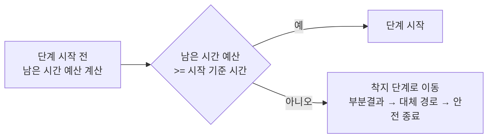
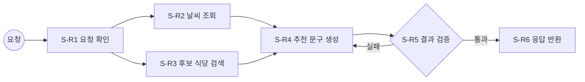

# 워크플로우와 커넥터 설계 가이드

## 0. 개요

워크플로우와 커넥터를 설계할 때 따르는 작성 기준임.  
워크플로우는 "어떤 단계를 어떤 순서로, 얼마 안에 끝내는가"를 정하고,  
커넥터는 "그 단계가 바깥 시스템과 어떻게 연결되는가"를 정함.

### 작성 순서 한눈에 보기

| 순서 | 작업 | 산출물 | 핵심 질문 |
|------|------|--------|-----------|
| ① | 단계 도출 및 순서 정의 | 흐름 도식 | 어떤 단계가 어떤 순서로 이어지나 |
| ② | 단계별 명세 작성 | 단계 명세표 | 각 단계는 무엇을 받아 무엇을 내놓나 |
| ③ | 외부시스템 연동 명세 작성 | 연동 명세표 | 바깥 연결이 얼마나 걸리고 실패하면 어떻게 하나 |
| ④ | 반복 구간 명세 작성 | 반복 구간 명세표 | 다시 도는 구간은 몇 번까지, 최대 얼마나 걸리나 |
| ⑤ | 워크플로우 명세 작성 | 워크플로우 명세표 | 전체가 시간 예산 안에 끝나나, 중단되면 어떻게 재개하나 |
| ⑥ | 커넥터 명세 작성 | 커넥터 목록과 유형별 명세 | 연결 대상의 주소, 입출력 형식은 무엇인가 |

- ③의 `커넥터ID`는 ⑥의 커넥터 목록 ID를 가리킴. ⑥에 없는 커넥터가 ③에 나오면 ⑥에 추가함
- 실행 중 시간 관리는 2절 「단계 시작 시 남은 시간 예산 측정」 규칙을 따름

### ID 규칙 요약

| 대상 | 형식 | 예시 | 비고 |
|------|------|------|------|
| 워크플로우 | `W-{N}` | `W-1` | |
| 단계 (동기 요청) | `S-R{N}` | `S-R1` | 사람이 요청하고 응답을 기다림 |
| 단계 (배치) | `S-B{N}` | `S-B1` | 정해진 시각이나 주기에 실행 |
| 단계 (이벤트) | `S-E{N}` | `S-E1` | 다른 시스템의 사건을 받아 실행 |
| 반복 구간 | `L-{N}` | `L-1` | |
| 커넥터 | `C-{NN}` | `C-01` | 두 자리 숫자 |

- 단계ID 접두어는 **워크플로우의 시작 트리거 유형**으로 정함. 한 워크플로우 안의 단계는 같은 접두어를 씀

---

## 1. 워크플로우 설계

### 1-1. ① 단계 도출 및 순서 정의

처리 절차: **단계 도출 → 처리 순서별로 나열 → 순차, 분기, 병렬, 반복 결정 → 도식화**

| 흐름 유형 | 판단 기준 | 도식 표현 |
|-----------|-----------|-----------|
| 순차 | 앞 단계의 출력이 뒤 단계의 입력임 | 화살표로 이음 |
| 분기 | 조건에 따라 둘 이상의 경로 중 하나만 감 | 마름모(조건) 뒤에 경로를 나눔 |
| 병렬 | 서로의 출력이 필요 없어 동시에 실행 가능 | 갈라졌다 다시 합쳐지는 경로 |
| 반복 | 결과가 기준에 못 미치면 앞 단계로 되돌아감 | 되돌아가는 화살표와 반복 구간 표시 |

- 작성 도구: 피그마 또는 draw.io로 직접 그림
- 생성형AI 활용: 단계 목록을 주고 PlantUML 또는 Mermaid 스크립트로 작성을 요청함
- 스크립트 보는 방법
  - PlantUML: planttext.com 접속 → 왼쪽에 스크립트 붙여넣기 → 오른쪽 PNG 또는 SVG를 마우스 오른쪽 메뉴로
    새 탭에서 열어 봄
  - Mermaid: mermaid.live/edit 접속 → 왼쪽에 스크립트 붙여넣기 → 오른쪽 위 전체보기 아이콘을 눌러 봄

### 1-2. ② 단계별 명세 작성

단계마다 아래 11개 항목을 표 한 행 또는 단계별 표 하나로 작성함.

| 항목 | 작성 방법 |
|------|-----------|
| 단계ID | 시작 트리거 유형별 접두어 + 번호. `S-R{N}`(동기 요청), `S-B{N}`(배치), `S-E{N}`(이벤트) |
| 단계명 | 현재 단계의 이름. 동사가 드러나게 씀 (예: "후보 식당 검색") |
| 이전 단계 | 바로 앞 단계의 단계명(또는 단계ID). 첫 단계는 "트리거"로 적음. 합류 지점은 앞 단계를 모두 적음 |
| 비즈니스 목표 | 이 단계의 작업을 **왜** 해야 하는지 한 문장으로 적음 |
| 입력 데이터 | 수행에 필요한 입력을 **필드 단위**로 적음 (필드명, 타입, 출처 단계) |
| 수행 작업 | 작업을 처리 순서대로 번호를 붙여 적음 |
| 출력 데이터 | 작업 결과로 생기는 데이터를 **필드 단위**로 적음 |
| 담당자 유형 | 규칙기반 코드, 예측형AI, 생성형AI, Human 중 하나 또는 복수 조합 (예: "생성형AI + Human") |
| 외부시스템 | 이 단계가 연동하는 외부 시스템명. 없으면 "없음" |
| 예외 처리 | 예외가 생겼을 때 할 일 (예: 입력 누락 시 사용자에게 재입력 요청) |
| 비고 | 개발에 필요한 기타 정보 |

- 담당자 유형은 "그 일을 누가 판단하나"로 고름

| 담당자 유형 | 고르는 경우 |
|-------------|-------------|
| 규칙기반 코드 | 정답이 정해져 있고 조건문으로 표현 가능 |
| 예측형AI | 과거 데이터로 학습한 분류, 점수, 수치 예측이 필요 |
| 생성형AI | 문장 작성, 요약, 판단 근거 설명처럼 정해진 정답이 없는 결과가 필요 |
| Human | 되돌릴 수 없는 결정, 책임 소재가 필요한 승인 |

### 1-3. ③ 외부시스템 연동 명세 작성

외부시스템을 쓰는 단계마다 작성함. 한 단계가 외부시스템 둘 이상을 쓰면 연동마다 1행씩 적음.

| 항목 | 작성 방법 |
|------|-----------|
| 단계ID | ②의 단계ID |
| 외부시스템 | 연동 대상 시스템명 |
| 연동 유형 | API, LLM, MCP, CLI 중 하나 |
| 커넥터ID | ⑥ 커넥터 목록의 ID. 목록에 없으면 목록에 새로 추가하고 그 ID를 적음 |
| 타임아웃 | 이 연동 1회 수행을 기다리는 최대 시간(초) |
| 재시도 횟수 | 타임아웃을 넘었을 때 다시 시도하는 횟수 |
| 최악값 | `타임아웃 × (1 + 재시도 횟수)`. 이 값을 넘으면 「초과 시 처리」로 빠짐 |
| 초과 시 처리 | 최악값을 넘었을 때의 처리 방법. 아래 순서로 검토하여 정함 |

**초과 시 처리 검토 순서**: 부분결과로 계속 → 대체 경로로 계속 → 안전 종료

| 순서 | 처리 방법 | 고르는 경우 | 예시 |
|------|-----------|-------------|------|
| 1 | 부분결과로 계속 | 이 단계 결과가 없어도 품질이 조금 낮은 결과를 낼 수 있음 | 날씨 정보 없이 추천 진행 |
| 2 | 대체 경로로 계속 | 같은 일을 하는 다른 수단이 있음 | 기본 모델 실패 시 보조 모델 호출 |
| 3 | 안전 종료 | 이 단계 없이는 결과를 낼 수 없음 | "잠시 후 다시 시도" 안내 후 종료 |

- 앞 순서가 가능하면 앞 순서를 택함. 안전 종료는 마지막 선택지임

### 1-4. ④ 반복 구간 명세 작성

분기에서 앞 단계로 되돌아가는 구간마다 작성함.

| 항목 | 작성 방법 |
|------|-----------|
| 반복구간ID | `L-{N}` |
| 비즈니스 목표 | 반복 구간이 하는 일 (예: 검증을 통과할 때까지 추천 문구 다시 생성) |
| 단계ID | `시작 단계ID ~ 종료 단계ID` (예: `S-R4 ~ S-R5`) |
| 재시도 횟수 | 구간을 다시 도는 최대 횟수 |
| 최악값 | `(구간 안 단계별 최악값 합계) × (1 + 재시도 횟수)` |
| 착지 단계 | 최악값을 넘거나 재시도를 다 써도 통과 못 했을 때 이어지는 단계. 1-3의 검토 순서로 정함 |

- 최악값 계산 예시

```text
반복구간 L-1 (재시도 2회)
  단계 1: 타임아웃 1초, 재시도 3회 → 단계 최악값 1 × (1+3) = 4초
  단계 2: 타임아웃 2초, 재시도 2회 → 단계 최악값 2 × (1+2) = 6초
  구간 최악값 = (4초 + 6초) × (1+2) = 30초
```

- 처음 1회 실행 + 재시도 2회 = 총 3회 실행이므로 `(1 + 재시도 횟수)`를 곱함
- 단계 명세(③)의 최악값 칸에는 반복 횟수를 곱하지 않음. 반복 횟수는 이 표에서만 곱함

### 1-5. ⑤ 워크플로우 명세 작성

| 항목 | 작성 방법 |
|------|-----------|
| 워크플로우ID | `W-{N}` |
| 이름 | 워크플로우 이름 |
| 비즈니스 목표 | 이 워크플로우를 **왜** 수행해야 하는지 적음 |
| 전체 시간 예산 | 워크플로우 수행에 배정한 총 시간(초). 최악값 합계가 이 시간 안에 들도록 각 단계 최악값을 조정함 |
| 종료 처리 시간 | 마지막에 결과를 정리하고 돌려주는 데 남겨 둘 시간(초). 2절 계산에 씀 |
| 최악값 합계 | `반복구간 밖 단계 최악값 합계 + 반복구간 최악값 합계` |
| 재개 방안 | 서버 장애로 중단됐을 때 재개 방법 |

- 최악값 합계 계산 규칙
  - 직렬 단계는 최악값을 더함
  - 병렬 구간은 그 안에서 **가장 큰 최악값 하나만** 더함
  - 분기 구간은 갈라진 경로 중 **가장 큰 경로의 값**을 더함
  - 반복 구간에 속한 단계는 단계별로 따로 더하지 않고, ④의 구간 최악값으로 한 번만 더함
- 점검: `최악값 합계 ≤ 전체 시간 예산`이 아니면 타임아웃, 재시도 횟수, 반복 횟수를 줄이거나 단계를 병렬로 바꿈
- 재개 방안 작성 기준

| 경우 | 표기 | 구현 |
|------|------|------|
| 처음부터 다시 해도 문제없음 (짧은 조회, 부작용 없음) | `해당없음` | 없음 |
| 다시 하면 비용이나 시간 손실이 큼, 또는 이미 바깥에 반영한 작업이 있음 | `단계별 결과 저장` | LangGraph + Checkpointer로 단계 결과를 저장하고 중단 지점부터 재개 |

---

## 2. 단계 시작 시 남은 시간 예산 측정

각 단계를 시작하기 전에 남은 시간 예산을 측정하여, 전체 시간 예산을 넘지 않을 때만 진행함.  
1-5의 최악값 합계가 "설계 시점" 점검이라면, 이 규칙은 "실행 시점" 점검임.

### 2-1. 계산 규칙

| 이름 | 계산식 |
|------|--------|
| 남은 시간 | `전체 시간 예산 - 기존 사용 시간 - 종료 처리 시간` |
| 남은 시간 예산 | `남은 시간 - SUM(앞으로 남은 단계의 외부시스템 연동 최악값)` |
| 시작 기준 시간 | `전체 시간 예산 × 비율(5%)` |
| 시작 조건 | `남은 시간 예산 ≥ 시작 기준 시간`일 때만 다음 단계 시작 |

- **반복 구간 안의 외부시스템 연동은 반복 횟수와 상관없이 1회분만 차감함**  
  단계를 시작할 때마다 다시 계산하므로, 1회분만 빼도 외부 연동 최악값 예산은 매번 확보됨
- **남은 단계에 분기가 있으면** 경로별 외부시스템 연동 최악값 합계를 구해 **가장 큰 값**을 차감함
- 기존 사용 시간은 워크플로우 시작 시각부터 실제로 흐른 시간(측정값)임. 설계값을 쓰지 않음

### 2-2. 판정 흐름



### 2-3. 계산 예시

```text
전체 시간 예산: 30초 / 종료 처리 시간: 1초
단계 1 ~ 4 수행 완료, 기존 사용 시간: 15초
남은 단계: 단계 5, 단계 6(외부 연동 최악값 3초), 단계 7, 단계 8(외부 연동 최악값 2초)
  ※ 단계 6 ~ 7은 반복 구간 L2(재시도 2회)이지만 단계 6의 3초는 1회분만 차감

남은 시간      = 30 - 15 - 1 = 14초
남은 시간 예산 = 14 - (3 + 2) = 9초
시작 기준 시간 = 30 × 5% = 1.5초
판정: 9초 ≥ 1.5초 → 단계 5 시작
```

---

## 3. 커넥터 설계

### 3-1. 커넥터 목록

| 항목 | 작성 방법 |
|------|-----------|
| ID | `C-{NN}` 형식 (예: `C-01`) |
| 커넥터명 | 커넥터의 목적이 드러나는 이름 (예: "날씨 조회 API") |
| 연동 방식 | API, MCP, CLI, LLM 중 하나 |
| 제공자 | 내부 시스템은 제공 부서, 외부 시스템은 제공 회사 |

- 연동 방식별로 3-2 ~ 3-5 중 해당하는 명세를 작성함
- 표에서 **커넥터 ID**는 모든 유형에 공통인 필수 항목이며 커넥터 목록의 ID와 같게 적음

### 3-2. REST API 설계

| 항목 | 작성 방법 |
|------|-----------|
| 커넥터 ID | 커넥터 목록의 ID와 같게 작성 |
| 베이스 URL | `http[s]://{호스트}:{포트}` 형태. 환경(개발, 운영 등)을 나눌 때는 환경별로 각각 작성 |
| 엔드포인트 | 메서드(POST, GET, PUT, PATCH, DELETE)와 경로를 함께 적음 (예: `GET /v1/weather`) |
| 요청 데이터 구조 | 필드마다 이름, 타입, 설명, 필수 또는 선택 |
| 응답 데이터 구조 | 필드마다 이름, 타입, 설명 |

### 3-3. MCP 설계

| 항목 | 작성 방법 |
|------|-----------|
| 커넥터 ID | 커넥터 목록의 ID와 같게 작성 |
| 전송 방식 | `STDIO` 또는 `HTTP` 중 하나 |
| 실행 방식 | STDIO: `{PATH}/{MCP 서버}` (실행 명령), HTTP: `{URL}` |
| 허용 도구 목록 | MCP 서버가 제공하는 도구 중 이 워크플로우가 호출할 도구만 적음 |
| MRTR 사용 | MRTR(Multi-Round Trip Request) 사용 여부. `사용` 또는 `미사용` |

- 허용 도구 목록은 "필요한 것만 허용"이 원칙임. 서버의 도구를 통째로 열지 않음

### 3-4. CLI 또는 스크립트 설계

| 항목 | 작성 방법 |
|------|-----------|
| 커넥터 ID | 커넥터 목록의 ID와 같게 작성 |
| 실행 명령 | 실행할 스크립트 경로나 명령 이름 |
| 인자 | 넘길 인자를 순서대로 적음 (예: `-i {입력 경로} -o {출력 경로}`) |

### 3-5. LLM 설계

| 항목 | 작성 방법 |
|------|-----------|
| 커넥터 ID | 커넥터 목록의 ID와 같게 작성 |
| 모델 | 모델명 |
| 하이퍼파라미터 | Temperature, Top-k, Top-p 등 모델이 제공하는 범위 안의 값 |
| 시스템 프롬프트 | `[목표]`, `[역할]`, `[맥락]`, `[입력]`, `[처리]`, `[출력]`, `[제약조건]` 섹션별로 작성. `references/prompt-guide.md`를 따름 |
| 유저 프롬프트 | 프롬프트에 채워 넣을 변수마다 이름, 타입, 설명, 필수 또는 선택 |
| 응답 데이터 구조 | 필드마다 이름, 타입, 설명 |

---

## 4. 작성 예시

간단한 동기 요청 워크플로우 하나로 모든 표를 채운 예시임.

### 4-1. 흐름 도식



### 4-2. 단계별 명세 (일부)

| 항목 | 값 |
|------|----|
| 단계ID | `S-R3` |
| 단계명 | 후보 식당 검색 |
| 이전 단계 | S-R1 요청 확인 |
| 비즈니스 목표 | 사용자 위치에서 걸어갈 수 있는 식당만 추천 대상으로 좁힘 |
| 입력 데이터 | `user_lat: float`, `user_lng: float`(S-R1), `radius_m: int`(S-R1, 기본 500) |
| 수행 작업 | 1. 반경 내 식당 검색 2. 영업 중인 곳만 남김 3. 거리순 상위 10개 선택 |
| 출력 데이터 | `candidates: list[{name: str, distance_m: int, category: str}]` |
| 담당자 유형 | 규칙기반 코드 |
| 외부시스템 | 식당 검색 MCP 서버 |
| 예외 처리 | 결과 0건이면 반경을 1,000m로 넓혀 1회 재검색 |
| 비고 | 영업 여부 판단은 서버 시각 기준 |

### 4-3. 외부시스템 연동 명세

| 단계ID | 외부시스템 | 연동 유형 | 커넥터ID | 타임아웃 | 재시도 | 최악값 | 초과 시 처리 |
|--------|-----------|-----------|----------|---------|--------|--------|-------------|
| `S-R2` | 날씨 API | API | `C-01` | 2초 | 1 | 4초 | 부분결과로 계속 (날씨 없이 추천) |
| `S-R3` | 식당 검색 MCP | MCP | `C-02` | 3초 | 1 | 6초 | 안전 종료 |
| `S-R4` | 문구 생성 모델 | LLM | `C-03` | 4초 | 0 | 4초 | 대체 경로로 계속 (정해진 문구 틀 사용) |

### 4-4. 반복 구간 명세

| 반복구간ID | 비즈니스 목표 | 단계ID | 재시도 | 최악값 | 착지 단계 |
|-----------|---------------|--------|--------|--------|-----------|
| `L-1` | 검증을 통과할 때까지 추천 문구 다시 생성 | `S-R4 ~ S-R5` | 2 | (4초 + 1초) × 3 = 15초 | 대체 경로로 계속 (정해진 문구 틀로 S-R6) |

- `S-R5` 결과 검증은 규칙기반 코드로 최악값 1초로 봄

### 4-5. 워크플로우 명세

| 항목 | 값 |
|------|----|
| 워크플로우ID | `W-1` |
| 이름 | 점심 메뉴 추천 |
| 비즈니스 목표 | 점심 메뉴 고민 시간을 줄여 바로 이동할 수 있게 함 |
| 전체 시간 예산 | 30초 |
| 종료 처리 시간 | 1초 |
| 최악값 합계 | S-R1 1초 + max(S-R2 4초, S-R3 6초) + L-1 15초 + S-R6 1초 = **23초** (≤ 30초) |
| 재개 방안 | 해당없음 (조회만 하고 바깥에 반영하는 작업이 없음) |

### 4-6. 커넥터 목록과 명세 (일부)

| ID | 커넥터명 | 연동 방식 | 제공자 |
|----|----------|-----------|--------|
| `C-01` | 날씨 조회 API | API | 기상 정보 제공 회사 |
| `C-02` | 식당 검색 MCP | MCP | 사내 플랫폼팀 |
| `C-03` | 추천 문구 생성 LLM | LLM | 모델 제공 회사 |

| 항목 (`C-02` MCP) | 값 |
|------|----|
| 커넥터 ID | `C-02` |
| 전송 방식 | HTTP |
| 실행 방식 | `https://mcp.example.internal/restaurant` |
| 허용 도구 목록 | `search_nearby`, `get_opening_hours` |
| MRTR 사용 | 미사용 |

---

## 5. 제출 전 점검표

- [ ] 모든 단계ID 접두어가 워크플로우 시작 트리거 유형(`S-R`, `S-B`, `S-E`)과 맞음
- [ ] 단계별 입력 데이터와 출력 데이터가 필드 단위로 적혀 있고, 입력의 출처 단계가 실제로 그 필드를 출력함
- [ ] 외부시스템이 "없음"이 아닌 단계는 모두 연동 명세(③)에 행이 있음
- [ ] 연동 명세의 커넥터ID가 모두 커넥터 목록에 있음
- [ ] 연동 최악값이 `타임아웃 × (1 + 재시도 횟수)`로 계산됨
- [ ] 초과 시 처리와 착지 단계를 부분결과 → 대체 경로 → 안전 종료 순서로 검토함
- [ ] 반복 구간 최악값이 `(구간 단계 최악값 합계) × (1 + 재시도 횟수)`로 계산됨
- [ ] 최악값 합계에서 병렬은 최댓값만, 분기는 가장 큰 경로만 더함
- [ ] `최악값 합계 ≤ 전체 시간 예산`
- [ ] 재개 방안이 `해당없음` 또는 `단계별 결과 저장`으로 적혀 있음
- [ ] 커넥터 유형별 명세(REST API, MCP, CLI, LLM)의 필수 항목이 빠짐없이 채워짐
- [ ] LLM 커넥터의 시스템 프롬프트가 `references/prompt-guide.md`의 섹션 구조를 따름
